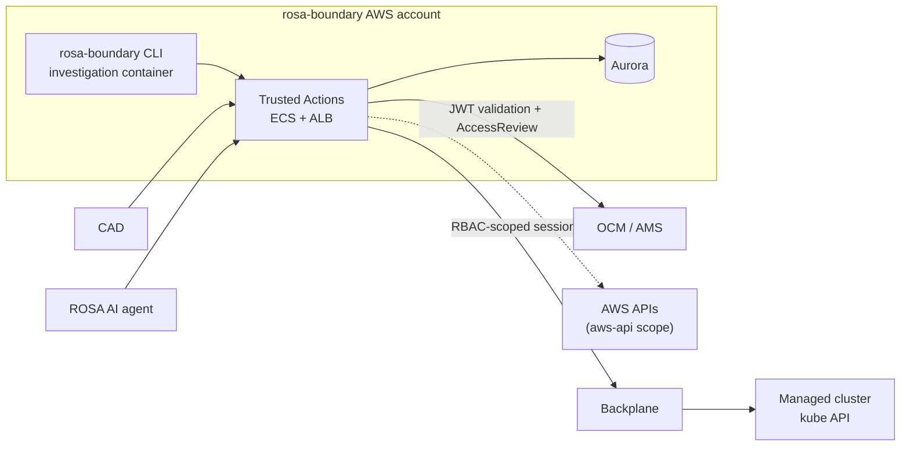

# Architecture

## Overview

OpenAPI-based HTTP API that accepts requests to execute one of a fixed catalog of *trusted actions* against a managed cluster. Trusted actions are modular, testable actions that are audited, persisted, and run asynchronously; the resulting output can later be retrieved through the API.

## Context

Trusted Actions is a provider: a narrow, audited, role-gated operation API. Consumers
include SREs working through rosa-boundary, Configuration Anomaly Detection, and the
ROSA AI agent — the roles allowed per action are listed in `internal/catalog`.

It runs on ECS behind an ALB, co-located in the rosa-boundary AWS account, and reaches
managed clusters only through Backplane, with a short-lived, RBAC-scoped session per
action. Dashed edges are not implemented yet:



## Project Structure

The code is split into two main layers:

* **Request handling**: router -> middleware -> handlers -> store
* **Action execution**: worker pool -> runner -> executor -> action -> backplane -> cluster/cloud provider

```
rosa-trusted-actions-server/
├── cmd/
│   ├── server              # main application entry point
│   └── action-cli          # standalone action execution client
├── internal/
│   ├── openapi             # generated from openapi/ via oapi-codegen
│   ├── handlers            # ServerInterface implementation
│   ├── catalog             # action registry
│   ├── actions             # action implementations
│   ├── executor            # authorize -> get client -> execute -> audit
│   ├── worker              # pool + ExecutorRunner, params -> ResourceTarget
│   ├── backplane           # client (real BP or kubeconfig for local dev)
│   ├── auth                # action-level authorization, authentication layer
│   ├── authorization       # resource-level authorization
│   ├── ocm                 # OCM SDK client
│   ├── store               # SQLite + Postgres, migrations
│   ├── middleware          # (audit, logging, recovery)
│   └── config              # env + optional YAML config file
├── openapi/                # OpenAPI 3.0 specification source files
└── api-spec.yaml           # Bundled OpenAPI spec (generated)
```

## Request Flow

1. `POST /api/v0/trusted-actions/{action}/run` -> OCM JWKS signature validation -> JWT authentication -> Audit MW injection -> AMS authorization + Action allowlist check -> Action validation/persistence
2. Worker claims pending execution -> ExecutorRunner resolves/decodes the action -> Executor validates the RBAC scope as well as a namespace/secret allowlist -> generates least-privilege, resource-scoped, backplane clients, and sets up auditing -> Action is executed

## Action Plugin Interface

Actions can be added by:

1. implementing the `Action` interface at `internal/actions/{action}.go`
1. initializing the Action `func init() { RegisterActionFactory(NewGetAction) }`
1. adding an `ActionDefinition` to the catalog at `internal/catalog/catalog.go`
1. the action is self-registered during package initialization

**Note**: implementing an Action and initializing it will not make it available to incoming requests: adding the ActionDefinition (step 3) is mandatory.

## API Design

### OpenAPI-First Development

The API is defined using OpenAPI 3.0 specifications in the `openapi/` directory. The build process:

1. Bundles multi-file OpenAPI specs into `api-spec.yaml`
2. Generates Go server interfaces and types using `oapi-codegen`
3. Custom handlers implement the generated `ServerInterface`

### Generated vs Custom Code

- **Generated**: `internal/openapi/api.go` - interfaces, types, routing (do not edit)
- **Custom**: `internal/handlers/api.go` - business logic implementing generated interfaces

## HTTP Server Architecture

### Server Configuration

The server is configured via:
- **CLI flags**: Server settings (listen address, log level, log format)
- **Environment variables**: Application configuration (AWS credentials, feature flags)

### Middleware Stack

Applied in order:
1. **Custom Logger**: Request/response logging with structured fields
2. **Request ID**: Generates unique ID for request tracing
3. **Recovery**: Panic recovery with stack trace logging
4. **Real IP**: Processes X-Forwarded-For headers
5. **Timeout**: 60-second request timeout
6. **CORS**: Permissive CORS policy for development
6. **Authentication** (action routes only): User identity captured from OCM JWT token
6. **Auditing** (action routes only): Requests are audited with a custom sink
6. **Authorization** (action routes only): Permission to run/get the output of actions is checked against allowed roles

### Request Routing

- Base path: `/api/v0/trusted-actions`
- Health check: `/health`
- API routes generated from OpenAPI specs and mounted via middleware-augmented (authn/z) OpenAPI handler.

## Configuration Management

### Structure

The `config.Config` struct separates:
- **Server config**: Overridden by CLI flags (listen address, logging)
- **AWS config**: Standard AWS environment variables
- **Security config**: Authentication and account restrictions
- **Workers config**: Number of workers and some time settings around those workers

### Environment Variables

- `AWS_*`: Standard AWS SDK environment variables for authentication
- `ROSA_TA_AUTH`: Enable/disable authentication enforcement. Valid values:
  - `disabled`
  - `enabled`: OCM settings are taken from TA (Trusted Action) config file
  - `ocmconfig`: OCM settings are taken from your OCM config file. Development only, probably requires you to run `ocm login` first.
- `ROSA_TA_ALLOWED_ACCOUNTS`: Comma-separated list of allowed AWS account IDs
- `DATABASE_URL`: Database connection string
- `ROSA_TA_WORKER_CONCURRENCY`: Number of execution workers
- `ROSA_TA_WORKER_POLL_INTERVAL`: Maximum interval between checks for pending executions when a worker has not received a new-work notification
- `ROSA_TA_WORKER_EXECUTION_TIMEOUT`: Max time allowed for an execution to process
- `ROSA_TA_ALLOWED_NAMESPACES`: Namespaces which can be targeted by actions
- `ROSA_TA_ALLOWED_SECRETS`: Secrets which can be used by actions

### Configuration file

Some of the above parameters can also be defined in a configuration file:
```yaml
workers:
    concurrency: 4
    poll_interval: 5s
    execution_timeout: 2m
actions:
    allowed_namespaces:
      - openshift-logging
      - openshift-monitoring
      - openshift-operators
    allowed_secrets:
      - openshift-logging/collector-config
      - openshift-monitoring/alertmanager-config
```

## Security

- Account allowlisting through configuration
- Audit logging of all API calls with caller identity

## Build System

### Make Targets

- `make generate`: Bundle OpenAPI spec → generate Go code
- `make build`: Generate code → compile binary
- `make test`: Run Go tests
- `make validate-spec`: Validate OpenAPI specification
- `make dev`: Live reload development server

### Code Generation Pipeline

```
openapi/*.yaml → bundle-spec → api-spec.yaml → generate-api → internal/openapi/api.go
```

## Error Handling

### HTTP Responses

Errors follow the OpenAPI-defined `Error` schema:
- `kind`: Always "Error"
- `code`: HTTP status-based error codes
- `reason`: Human-readable error message

### Panic Recovery

The recovery middleware catches panics and:
- Logs panic with stack trace
- Returns 500 Internal Server Error
- Includes request ID for correlation

## Logging

### Structured Logging

Uses Logrus with configurable output:
- **JSON format**: For production/structured log aggregation
- **Text format**: For development/human readability
- **Log levels**: debug, info, warn, error

### Request Context

Logs include:
- Request ID for tracing
- HTTP method and URI
- Error details and stack traces (for panics)

## Storage

SQLite for local dev, Postgres otherwise. Schema in `internal/store/migrations`:

```
executions ──1:1──> executions_output
     ▲
     └──────────── audit_entries (execution_id, nullable)
```
