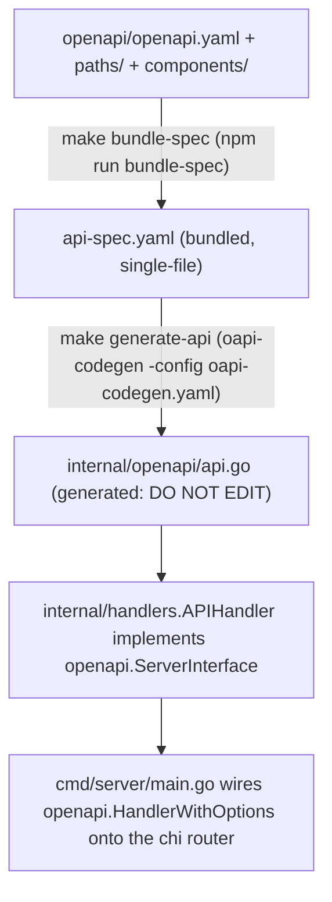
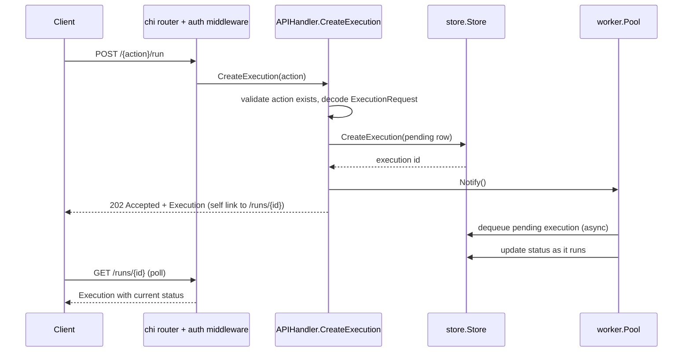

The Trusted Actions server exposes its HTTP API as the generated artifact of a
multi-file OpenAPI specification. The specification is the source of truth for
request/response shapes, path parameters, and error formats; Go server code is
generated from it and must never be edited by hand. Business logic lives in a
separate, hand-written package that implements the generated server interface.

## Spec layout

The spec lives under [`openapi/`](../../openapi/openapi.yaml) and is split into
small files that are assembled by reference:

- `openapi/openapi.yaml` — the entrypoint: `info`, `servers`, `tags`, the
  top-level `paths` map (each entry is a `$ref` into `openapi/paths/`), and the
  `ocm_jwt` security scheme applied as the default security requirement.
- `openapi/paths/` — one YAML file per path, using `@` as a path-separator
  token for nested/parameterized segments (e.g. `{action}@run.yaml` for
  `/{action}/run`, `runs@{id}.yaml` for `/runs/{id}`). Each file defines the
  operation(s) for that path: `operationId`, parameters, request body, and a
  `responses` map keyed by status code, each referencing a schema in
  `openapi/components/schemas/`.
- `openapi/components/schemas/` — the data model: `Error`, `Execution`,
  `ExecutionRequest`, `ExecutionOutput`, `ExecutionList`, `TrustedAction`,
  `TrustedActionSummary`, `TrustedActionCatalog`, `AuditEntry`, `AuditList`,
  `HALLink`/`ExecutionLinks`/`ExecutionOutputLinks`, and the shared enums
  (`ExecutionStatus`, `ApprovalState`, `Scope`, `ActionType`).
- `openapi/components/securitySchemes/ocm_jwt.yaml` — the bearer-JWT security
  scheme referenced from the entrypoint.

See [`openapi/README.md`](../../openapi/README.md) and
[`openapi/paths/README.md`](../../openapi/paths/README.md) for the conventions
this layout follows (file-per-path, `@` separator, path parameters in `{}`).

## Bundle → generate pipeline

Multi-file specs cannot be fed directly to a code generator, so the build
bundles them into a single file first:

1. `make bundle-spec` runs `npm run bundle-spec`, which resolves every `$ref`
   starting from `openapi/openapi.yaml` and writes a single-file spec to
   `api-spec.yaml` at the repo root (`BUNDLED_SPEC_PATH` in the `Makefile`).
2. `make generate-api` runs oapi-codegen against `api-spec.yaml` using
   `oapi-codegen.yaml` as config (`package: openapi`,
   `output: internal/openapi/api.go`, generating both `chi-server` bindings
   and `models`), producing `internal/openapi/api.go`.
3. `make generate` runs both steps (`bundle-spec` then `generate-api`) and is
   a prerequisite of `make build`, `make run`, `make test`, and related
   targets, so the generated file is always refreshed before it is compiled
   against.
4. `make validate-spec` runs `npm run validate-spec` to lint the spec
   (independent of code generation) and is the way to catch malformed specs
   before they reach codegen.
5. `make watch-spec` (requires `entr`) re-runs `make generate` whenever a
   `.yaml`/`.yml` file under `openapi/` changes, for local iteration.

*Bundle → generate → implement pipeline from spec files to the running server.*

## Generated vs. hand-written code

`internal/openapi/api.go` carries the header
`// Code generated by github.com/oapi-codegen/oapi-codegen/v2 ... DO NOT EDIT.`
and must never be hand-edited — any change belongs in the YAML spec, after
which `make generate` regenerates the file. It defines:

- Request/response **types** for every schema (`Error`, `Execution`,
  `ExecutionRequest`, `TrustedActionCatalog`, `AuditList`, HAL link types,
  etc.) and `Valid()` helpers for each enum (`ExecutionStatus`,
  `ApprovalState`, `Scope`, `ActionType`, …).
- The `ServerInterface`, one method per `operationId` (`Catalog`, `Describe`,
  `CreateExecution`, `ListExecutions`, `GetExecution`, `GetExecutionOutput`,
  `ListAuditEntries`), each carrying typed path/query parameters (e.g.
  `ListExecutionsParams`, `types.UUID` for `{id}`).
- `HandlerWithOptions`, which mounts all operations as chi routes on a
  `BaseRouter`, and the `MiddlewareFunc` type used to inject
  operation-scoped middleware (e.g. action-level authorization, see below).

[`internal/handlers/api.go`](../../internal/handlers/api.go) is the
hand-written counterpart: `APIHandler` implements `openapi.ServerInterface`
(enforced at compile time via `var _ openapi.ServerInterface = (*APIHandler)(nil)`)
and holds the dependencies business logic needs — a `logger`, the
`catalog.Catalog`, the `store.Store`, and an `ExecutionNotifier` used to wake
the worker pool immediately after an execution is queued rather than waiting
for its next poll interval. `cmd/server/main.go` constructs an `APIHandler`
and passes it to `openapi.HandlerWithOptions`, wiring authentication,
audit-logging, and authorization middleware around the whole
`/api/v0/trusted-actions` route tree (see
[Architecture Overview](overview.md) for how this sits inside the full
request pipeline, and
[Trusted Actions Catalog](../concepts/trusted-actions-catalog.md) for how
`catalog.Catalog` and action definitions back the `Catalog`/`Describe`
handlers).

## The `Error` schema and error responses

Every error response in the spec uses one schema
(`openapi/components/schemas/Error.yaml`), with three required fields:

- `kind` — always the literal string `"Error"` (generated as the
  `openapi.ErrorKindError` constant).
- `code` — a short machine-readable code (e.g. `invalid-params`,
  `unknown-action`, `write-cooldown`, `not-found`).
- `reason` — a human-readable message.

Two independent call sites build this schema and both currently derive `code`
mechanically as `HTTP_<status>` rather than the semantic codes shown in the
spec's examples (e.g. `unknown-action`, `write-cooldown`):

- `handlers.APIHandler.respondError` (`internal/handlers/api.go`) is used by
  every `ServerInterface` method; it logs the error via `logrus`, builds an
  `openapi.Error{Kind: openapi.ErrorKindError, Code: fmt.Sprintf("HTTP_%d",
  status), Reason: message}`, writes the status code, and renders the body
  with `render.JSON`.
- `auth.respondError` (unexported, in `internal/auth/authn.go`) serves the
  same shape for authentication/authorization failures raised in middleware
  (`internal/auth/authn.go`, `internal/auth/authz.go`) — i.e. before a request
  ever reaches `APIHandler` — so 401s ("Authentication required.") and 403s
  ("Access denied.") returned by the auth layer are structurally identical to
  errors returned by the handlers.

Separately, `middleware.Recoverer` (`internal/middleware/middleware.go`) is a
chi-style middleware installed early in the router chain
(`cmd/server/main.go`) that recovers from panics anywhere downstream, logs the
panic value, stack trace, and request metadata, and writes a plain-text
`500 Internal Server Error` via `http.Error` — this path does **not** produce
the structured `Error` JSON body, since a panic means the handler never
reached a point where it could call either `respondError`.

## Main endpoints

| Method & path | `operationId` | Handler | Behavior |
|---|---|---|---|
| `GET /` | `catalog` | `Catalog` | Lists all registered Trusted Actions (summary fields only: name, scope, type, description). Declared `security: []` in the spec. |
| `GET /{action}` | `describe` | `Describe` | Full detail for one action: parameters, authorization policy, write cooldown, dry-run config. 404 if unknown. Declared `security: []` in the spec. |
| `POST /{action}/run` | `createExecution` | `CreateExecution` | Creates and queues an execution; returns `202 Accepted`. |
| `GET /runs` | `listExecutions` | `ListExecutions` | Paginated, filterable list of executions (status, action, target, operator, scope, type, approval_state, dry_run, force, since). |
| `GET /runs/{id}` | `getExecution` | `GetExecution` | Execution metadata plus HAL `_links`. |
| `GET /runs/{exec_id}/output` | `getExecutionOutput` | `GetExecutionOutput` | Execution output (message + resources), only populated for terminal executions. |
| `GET /audit` | `listAuditEntries` | `ListAuditEntries` | Paginated, filterable API call audit log. |

### `GET /` (Catalog) and `GET /{action}` (Describe)

`Catalog` calls `catalog.Catalog.All()` and maps each definition to
`openapi.TrustedActionSummary` via `ToOpenAPISummary()`; `Describe` looks up a
single action with `catalog.Catalog.Get(action)` and maps it to
`openapi.TrustedAction` via `ToOpenAPIDetail()`, returning `404 Unknown
action` if the name is not registered. Both operations are declared
`security: []` in their path files, marking them as intentionally public in
the spec. In practice, `cmd/server/main.go` mounts
`authnMiddleware.AuthenticateAccountJWT` on the entire
`/api/v0/trusted-actions` chi sub-tree before `openapi.HandlerWithOptions` is
reached, so the per-operation `security: []` override is not currently
enforced — every request, including catalog/describe, requires a valid JWT. A
`TODO` in `main.go` flags this gap explicitly: the CLI needs these two
discovery endpoints to work without credentials, and the fix is either to
split them into a separate public route group ahead of the auth middleware,
or have the CLI degrade gracefully when it has no credentials yet. See
[CLI & Clients](../workflows/cli-clients.md) for how `action-cli`/`rta` call
these endpoints today.

### `POST /{action}/run` (CreateExecution)

Validates the action exists, decodes `openapi.ExecutionRequest` from the body,
resolves the caller's identity from context (set by the auth middleware),
builds a `models.Execution` via `models.ExecutionFromRequest`, and persists it
with `store.Store.CreateExecution` — the row is written in `pending` status.
It then calls `notifier.Notify()` so the worker pool can dequeue and start the
execution immediately instead of waiting for its next poll tick, attaches the
execution ID / target cluster / Jira ticket / approval state to the request's
audit context (so the audit-log middleware can record them), and responds
`202 Accepted` with the created `Execution` (including a `self` HAL link
pointing at `GET /runs/{id}`). The actual run happens asynchronously in a
background worker — this handler never blocks on execution completion. See
[Data Model & Persistence](../concepts/data-model-and-persistence.md) for the
`Execution` row's full lifecycle and [Trusted Actions Catalog](../concepts/trusted-actions-catalog.md)
for per-action authorization, dry-run, and write-cooldown rules enforced
before an execution is queued.

*Submitting a Trusted Action run returns immediately; completion is observed by polling `GET /runs/{id}`.*

### `GET /runs` and `GET /runs/{id}` (ListExecutions, GetExecution)

`ListExecutions` builds a `store.ExecutionFilter` from query parameters
(action, target, operator, status, scope, type, approval_state, dry_run,
force, since — `since` accepts either an RFC3339 timestamp or a duration
shorthand like `30s`/`5m`/`1h`/`24h`/`7d`, parsed by the handler's `parseSince`
helper), applies pagination (`page`/`limit`, default limit 20, validated
against integer overflow), and returns an `openapi.ExecutionList` with
`total`/`page`/`limit`/`has_more` metadata. List responses carry execution
metadata only.

`GetExecution` fetches one execution by UUID (returning `404` via
`store.ErrNotFound`), sets a `self` HAL link to its own URL, and — only if
`store.Store.GetExecutionOutput` succeeds for that ID — adds an `output` HAL
link pointing at `GET /runs/{id}/output`. The link is populated reactively per
request by probing whether output exists, rather than being a static
property of the execution record, so clients should follow `_links.output`
rather than hard-code the `/output` path.

The `openapi.yaml` top-level description still documents the aspirational
workflow step "`GET /runs/{id}?include=output,logs` (opt-in content)", but no
`include` query parameter exists in `runs@{id}.yaml` today, and
`GetExecution`/`GetExecutionOutput` implement output retrieval as a separate
endpoint (`GET /runs/{exec_id}/output`) instead of an `?include` toggle on the
execution resource. There is no dedicated "logs" artifact distinct from
output either — `ExecutionOutput.message` doubles as the execution's
message/log text. This endpoint shape is a placeholder: it depends on a
persistent output/log storage backend that does not yet exist, and the
`?include=output,logs` query-parameter design referenced in the spec
description has not been implemented against it.

### `GET /audit` (ListAuditEntries)

Mirrors the `ListExecutions` pagination/filtering pattern (page/limit,
action/target/operator/method/approval_state/since filters) over
`store.Store.ListAuditEntries`, returning an `openapi.AuditList` with the same
`total`/`page`/`limit`/`has_more` shape plus `kind: AuditList`. Per the spec
description, every API call except `catalog` and `describe` is recorded; all
audit entries share one schema where fields not applicable to a given call
type are empty strings rather than omitted.

## Related pages

- [Architecture Overview](overview.md) — where the API server sits relative
  to the worker pool, auth, and store.
- [Data Model & Persistence](../concepts/data-model-and-persistence.md) —
  the `Execution`/`AuditEntry` row shapes these endpoints read and write.
- [Trusted Actions Catalog](../concepts/trusted-actions-catalog.md) — how
  `catalog.Catalog` definitions back `Catalog`/`Describe`/`CreateExecution`.
- [CLI & Clients](../workflows/cli-clients.md) — client-side consumers of
  this API surface.
