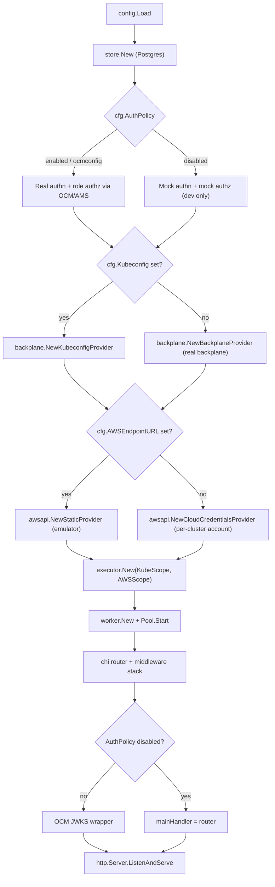
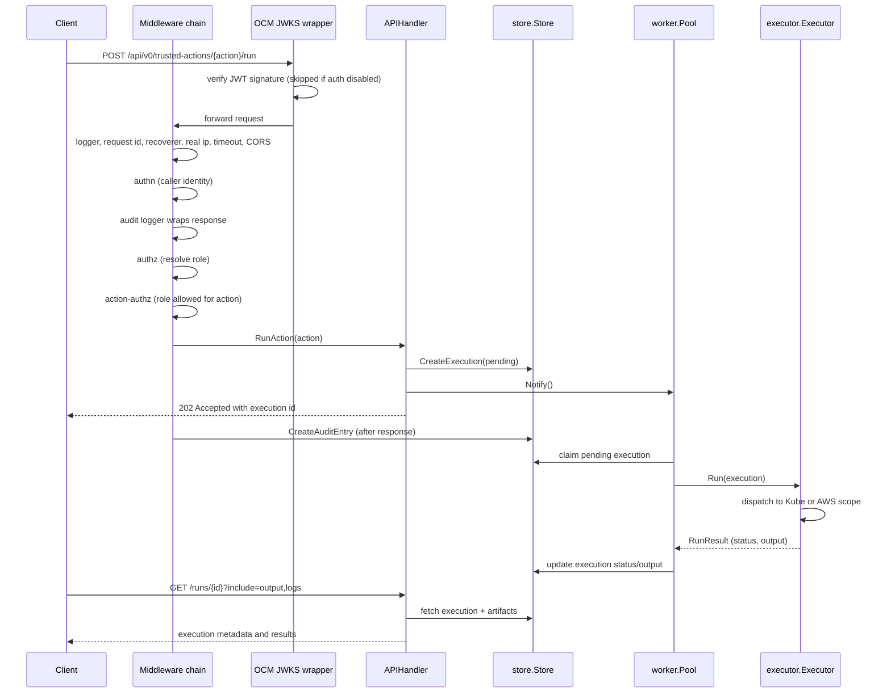

## What this process is

The ROSA Trusted Actions Server is a single Go binary (`cmd/server/main.go`) that
exposes an HTTP API for submitting and tracking "trusted actions" — operations
executed against Red Hat managed OpenShift clusters (via backplane) and AWS
accounts. A request either gets served synchronously (catalog lookups, status
polling) or enqueues an execution that a background worker pool later claims
and runs against a cluster or AWS. All durable state — execution metadata,
audit entries, and trusted action results — lives behind the `store.Store`
interface (`internal/store`), with the actual execution and logs handled by
the executor and stored per configuration.

The process has two concurrently running parts after startup:

- an HTTP server (`chi` router wrapped in optional OCM JWKS middleware) handling
  API traffic, owned by `internal/handlers` and `internal/middleware`;
- a `worker.Pool` (`internal/worker`) that polls the store for pending
  executions and runs them through `internal/executor`, off the request path.

Both are wired together in `main.go` and share the same `store.Store`, logger,
and `executor.Executor`.

## Startup wiring (`cmd/server/main.go`)

`runServer` performs an ordered sequence of initialization steps; each step's
output feeds the next, and several steps contain fail-fast safety checks
that stop the server rather than let it run in a silently dangerous
configuration:

1. **Load configuration** — `config.Load(configFilePath)` reads environment
   variables and an optional YAML config file into `config.Config`
   (`internal/config`), then CLI flags (`--listen-addr`, `--log-level`,
   `--log-json`) override the corresponding fields. See
   [Configuration](../operations/configuration.md) for the full settings
   reference.
2. **Initialize the store** — `store.New` opens the Postgres-backed
   `store.Store` using `cfg.DatabaseURL` and connection-pool settings. This is
   the only durable record of executions and audit entries; the process
   cannot serve traffic meaningfully without it.
3. **Select the authn/authz policy** — based on `cfg.AuthPolicy`
   (`ROSA_TA_AUTH`):
   - `enabled` / `ocmconfig`: real JWT authentication (`auth.NewAuthMiddleware`)
     plus role-based authorization resolved through AMS AccessReview
     (`auth.NewRoleAuthzMiddleware`), backed by an `ocm.Client` built either
     from TA config (`enabled`) or the local `ocm login` config
     (`ocmconfig`, development only). Requires at least one role mapping
     (`cfg.Roles`) to be configured, or the server refuses to start.
   - `disabled`: mock identity `dev-user` with a hardcoded SREP role
     (`auth.NewMockAuthMiddleware`, `auth.NewMockAuthzMiddleware`) — never for
     production. See the safety guards below.
   - Any other value is a fatal configuration error.
4. **Build the execution pipeline** — an `authorization.Authorizer`
   (namespace/secret allowlists), a mock `audit.Logger` for per-action
   decisions, and a `backplane.ClientProvider` chosen by whether
   `cfg.Kubeconfig` is set (local kubeconfig vs. the real backplane API over
   an OCM connection). An AWS region allowlist and
   `authorization.AWSPolicy` are built next, followed by an
   `awsapi.ClientProvider` chosen by whether `cfg.AWSEndpointURL` is set
   (static single-account provider for a local emulator vs. a
   cloud-credentials provider that resolves each cluster's own AWS account
   through backplane). These two provider pairs mirror each other: kubeconfig
   vs. backplane, and endpoint-override vs. cloud-credentials.
5. **Assemble the executor** — `executor.New` registers one `executor.Scope`
   per execution domain (`executor.NewKubeScope`, `executor.NewAWSScope`);
   every registered trusted action must be claimed by exactly one scope.
6. **Start the worker pool** — `worker.New` wraps the executor in a
   `worker.NewExecutorRunner` (applying `cfg.WorkerExecutionTimeout`) and
   starts `cfg.WorkerConcurrency` goroutines polling the store on
   `cfg.WorkerPollInterval`. `workerPool.Start(workerCtx)` returns
   immediately; the pool runs until `workerCtx` is cancelled during shutdown.
7. **Build the handler and router** — `handlers.NewAPIHandler` wraps the
   catalog, store, and worker pool (as an `ExecutionNotifier`) behind the
   generated `openapi.ServerInterface`. A `chi.Router` is created and the
   middleware stack (below) is attached.
8. **Wrap with the OCM JWKS handler** — only when `cfg.AuthPolicy !=
   DisabledAuthPolicy`: `authentication.NewHandler()` from the OCM SDK
   validates JWT signatures against a JWKS endpoint before the request
   reaches the chi router, and marks `^/health$` as public so health checks
   never need a token. In disabled-auth mode this wrapper is skipped
   entirely, avoiding a network call and a `Fatal` at startup.
9. **Serve and wait for shutdown** — an `http.Server` listens on
   `cfg.ListenAddr`; `SIGINT`/`SIGTERM` trigger graceful shutdown (below).

*Startup wiring: configuration and provider selection cascade into the executor, worker pool, and HTTP handler chain.*

### Safety guards at startup

Two checks exist specifically to stop a dangerous half-configured deployment
from starting, rather than failing (or silently misbehaving) per request
later:

- **`ROSA_TA_AUTH=disabled` requires `ROSA_TA_KUBECONFIG` and
  `ROSA_TA_AWS_ENDPOINT_URL`.** Disabled auth hands every request the
  hardcoded SREP role. Without a kubeconfig override, the backplane provider
  would reach *real* production cluster infrastructure under that mock
  identity; without an AWS endpoint override, the AWS SDK's default
  credential chain would pick up whatever ambient AWS credentials the host or
  pod has and reach a *real* AWS account. Both are refused with a `Fatal` at
  startup so an unauthenticated local/dev configuration can never reach
  production systems.
- **An empty AWS region allowlist refuses to start.** There is no built-in
  default region allowlist (`cfg.AWSAllowedRegions`). An unconfigured
  deployment would otherwise start cleanly, serve the catalog normally, and
  fail *every* AWS execution with a policy error — a failure mode visible
  only to whoever first tries to run an AWS action, not to whoever deployed
  it. Refusing to start surfaces the missing setting immediately to the
  operator instead.

## Middleware stack and route split

All global middleware is attached to the chi router in this fixed order
(`internal/middleware`, `go-chi/chi/v5/middleware`, `go-chi/cors`):

1. **Logger** (`middleware.NewLogger`) — structured request/response logging
   (method, URI, status, byte count, duration, request ID) via Logrus.
2. **Request ID** (`middleware.RequestID`) — reads `X-Request-ID` or generates
   one, stores it in context and echoes it back as a response header, so
   later log lines and the recovery handler can correlate to the same
   request.
3. **Recoverer** (`middleware.Recoverer`) — catches panics, logs the panic
   value and stack trace with the request ID, and returns `500 Internal
   Server Error` instead of crashing the process.
4. **Real IP** (`chi/middleware.RealIP`) — rewrites `r.RemoteAddr` from
   `X-Forwarded-For`/`X-Real-IP` so downstream logging and audit entries see
   the client's real address behind a proxy.
5. **Timeout** (`chi/middleware.Timeout`, 60s) — wraps the handler in
   `http.TimeoutHandler` so a stuck handler cannot hold a request open
   indefinitely.
6. **CORS** (`go-chi/cors`) — a permissive policy (`AllowedOrigins: ["*"]`,
   common methods and headers including the `X-Amz-*` SigV4 headers) intended
   for development; see [Configuration](../operations/configuration.md) if
   this needs to be tightened for a given deployment.

These six apply to every route, including `/health`. The API sub-tree adds
three more, scoped only to `/api/v0/trusted-actions`:

7. **Authn** (`authnMiddleware.AuthenticateAccountJWT`) — validates the caller
   identity extracted from the JWT (already signature-verified by the OCM
   JWKS wrapper, when enabled) and stores it in context; rejects with `401`
   if missing or malformed.
8. **Audit logger** (`middleware.NewAuditLogger`) — wraps the response
   writer, lets the request proceed, then persists an `AuditEntry` row (via
   `store.Store.CreateAuditEntry`) with method, path, caller username, status
   code, and any handler-populated fields (execution ID, Jira reference,
   approval state, target cluster) retrieved from
   `middleware.GetAuditContext`. The write uses a detached 5-second context
   because the request context may already be cancelled by the time the
   handler returns.
9. **Authz** (`authzMiddleware.AuthorizeAPI`) — resolves the caller's role
   (real role-mapping/AMS lookup, or mock role in disabled mode) and stores
   it in context for downstream checks.

A tenth, **action authorization** (`actionAuthz.CheckActionAccess`), is
registered as an `openapi.MiddlewareFunc` passed to
`openapi.HandlerWithOptions`, so it runs per-operation rather than as a
blanket chi middleware. It looks up the `{action}` URL parameter against the
`auth.ActionCatalog`, requires a resolved role in context, and `403`s unless
that role is in the action's `AllowedRoles`. Requests with no `{action}`
parameter (such as the catalog list) pass through unchecked, relying on the
upstream authn/authz layers. See
[Authorization Model](../concepts/authorization-model.md) for the role and
action-permission semantics in detail.

### Route split

- `GET /health` is mounted directly on the router, outside the
  `/api/v0/trusted-actions` route group, so it only goes through the six
  global middlewares — no authentication, no audit logging. It is also marked
  `Public("^/health$")` in the OCM JWKS wrapper so it bypasses JWT signature
  validation too. This keeps liveness/readiness probes working independent
  of auth configuration or OCM availability.
- `/api/v0/trusted-actions/...` is a `chi.Router` sub-route carrying authn,
  audit, and authz middleware, with the generated OpenAPI routes
  (`openapi.HandlerWithOptions`, implemented by `internal/handlers`) mounted
  onto it via `BaseRouter` (mounting via `BaseRouter` directly, rather than
  `r.Mount("/", r)`, avoids an infinite routing loop). See
  [API Surface](api-surface.md) for the full endpoint list.

## Request path: trusted-action execution

A `POST /{action}/run` request exercises the whole stack end to end: it
passes through every middleware layer, is handled synchronously up to
enqueuing the execution, and then is completed asynchronously by the worker
pool. The sequence below shows that split.

*A trusted-action run: synchronous enqueue through the middleware chain, then asynchronous execution by the worker pool, polled by the client afterward.*

The handler never calls the executor directly; it only creates the pending
`models.Execution` row and calls `Notify()` so an idle worker wakes
immediately instead of waiting for the next poll tick. Correctness does not
depend on that notification arriving — a missed notify, or a row inserted by
any other path, is still picked up on the next `pollInterval` tick
(`internal/worker/pool.go`). See
[Execution Pipeline](../concepts/execution-pipeline.md) and
[Executing a Trusted Action](../workflows/executing-a-trusted-action.md) for
the full lifecycle, including how the executor picks a scope and talks to
backplane or AWS.

## Graceful shutdown

On `SIGINT`/`SIGTERM`, `runServer`:

1. Cancels `workerCtx`, signaling worker goroutines to stop picking up new
   executions.
2. Calls `srv.Shutdown(ctx)` with a 30-second timeout, which stops accepting
   new connections and waits for in-flight HTTP handlers to finish.
3. Waits (up to the same deadline) for `workerPool.Wait()`, which blocks
   until all worker goroutines have exited — logging a warning if in-flight
   executions did not finish before the timeout.

This ordering means an execution already claimed by a worker is allowed to
finish (or at least attempt to) before the process exits, rather than being
abandoned mid-run.

## Owning packages

| Responsibility | Package |
|---|---|
| HTTP request handlers implementing the generated OpenAPI interface | `internal/handlers` |
| Cross-cutting HTTP concerns: logging, request ID, recovery, audit persistence | `internal/middleware` |
| Configuration loading, validation, and defaults | `internal/config` |
| Background execution polling and lifecycle | `internal/worker` |
| Dispatching claimed executions to Kubernetes/backplane or AWS scopes | `internal/executor` |
| Authentication and role/action authorization | `internal/auth` |
| Durable storage of executions, audit entries, and action definitions | `internal/store` |

Related pages: [API Surface](api-surface.md),
[Authorization Model](../concepts/authorization-model.md),
[Execution Pipeline](../concepts/execution-pipeline.md),
[Configuration](../operations/configuration.md),
[Executing a Trusted Action](../workflows/executing-a-trusted-action.md).
