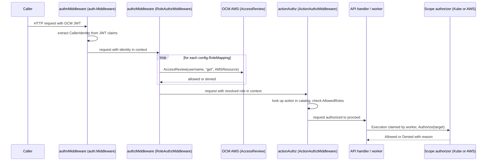

# Authorization Model

ROSA Trusted Actions decides whether a request may run in two distinct stages: an
**API-level** stage that authenticates the caller and resolves a coarse role, and an
**action-level** / **resource-level** stage that checks the specific action and the
specific Kubernetes or AWS resource it targets. The two stages are implemented in
different packages (`internal/auth` and `internal/authorization`) and run at different
times (HTTP request time vs. execution time), and both must allow a request for it to
succeed.

## Layering overview

*Caption: a request passes through four checks — JWT identity, AMS role resolution, per-action role catalog, and finally a per-scope resource authorizer — before an action actually runs against Kubernetes or AWS.*

The four layers, in order:

1. **`authnMiddleware`** (`auth.Middleware.AuthenticateAccountJWT`, `internal/auth/authn.go`) —
   establishes *who* is calling. It reads the verified JWT token the OCM SDK's
   `authentication.Handler` already placed in the request context (see
   [OCM Integration](../integrations/ocm.md)), extracts a `CallerIdentity`
   (`Username`, `Email`, `ClientID`) from RHSSO or RHD claim keys
   (`internal/auth/context.go`), and stores it in the request context. A request with no
   token, or a token missing a username claim, is rejected with `401 Unauthorized`
   before any role or action logic runs.
2. **`authzMiddleware`** (`auth.RoleAuthzMiddleware.AuthorizeAPI`, `internal/auth/authz.go`) —
   resolves *which coarse role* the caller has. It iterates the configured
   `config.RoleMapping` list (`roles:` in the config file, each mapping a role `ID` to
   an `AMSResource`) and calls `ocm.Authorization.AccessReview(ctx, username, "get",
   AMSResource)` for each one in order, stopping at the first role AMS grants. The
   resolved role ID (e.g. `SREP`, `ConfigurationAnomalyDetection`, `ROSAAiAgent`) is
   stored in the context for downstream checks. If every `AccessReview` call fails,
   the request gets `500`; if all succeed but none grant access, it gets
   `403 Forbidden`. `ROSA_TA_ROLES_CONFIG` is no longer read — roles must be configured
   under the `roles:` key in the config file (see
   [Configuration](../operations/configuration.md)).
3. **`actionAuthz`** (`auth.ActionAuthzMiddleware.CheckActionAccess`, `internal/auth/authz.go`) —
   resolves *which specific action* the resolved role may invoke. Chi routes carrying an
   `{action}` URL parameter are matched against the `ActionCatalog` (`internal/catalog`);
   each `ActionDefinition` declares its own `AllowedRoles` list, so different actions can
   be restricted to different roles even though they all share the same AMS-resolved
   role. An unknown action yields `404`; a role not in `AllowedRoles` yields `403`.
   Requests without an `{action}` param pass through untouched, relying on the upstream
   authn/authz layers.
4. **Per-scope `authorization.Authorizer`** (`internal/authorization`) — resolves
   *which specific resource* the action may touch, evaluated not at HTTP request time
   but later, when a worker actually executes the claimed action (see
   [Execution Pipeline](execution-pipeline.md)). `executor.KubeScope` and
   `executor.AWSScope` each hold their own authorizer and call it from their
   `Authorize(req Request)` method before `Run` is allowed to touch a real cluster or
   AWS account. This is the layer documented in detail below.

In `cmd/server/main.go`, the router wires layers 1–3 as chi middleware on the whole
`/api/v0/trusted-actions` subtree (`authnMiddleware.AuthenticateAccountJWT`, then
`middleware.NewAuditLogger`, then `authzMiddleware.AuthorizeAPI`, then
`actionAuthz.CheckActionAccess` applied as an OpenAPI handler middleware), so every
action route is always authenticated, role-resolved, and action-checked before the
handler runs. Layer 4 is wired separately into `executor.New` alongside the worker
pool, because an execution can be claimed and run well after the originating HTTP
request has completed.

## Kubernetes authorizer

`authorization.New` (`internal/authorization/authorization.go`) builds the Kubernetes
resource authorizer used by `executor.KubeScope`. It is constructed with two
allowlists — namespaces and secrets — both supplied as plain string slices and turned
into lookup sets.

- **Permissive mode when unconfigured.** If the namespace allowlist is empty (the
  default when `ROSA_TA_ALLOWED_NAMESPACES` / `cfg.AllowedNamespaces` is unset), the
  authorizer allows every request, logging only at debug level. This is deliberately
  the opposite of the AWS authorizer's fail-closed stance, intended for local
  development and cluster-scoped-only deployments; **production deployments must set
  `ROSA_TA_ALLOWED_NAMESPACES`** to actually restrict access.
- **Namespace allowlist enforcement.** Once any namespace is configured, every
  namespaced request must carry a namespace (a namespaced request with no namespace is
  denied), and that namespace must be a member of the allowlist or the request is
  denied with a reason naming the offending namespace.
- **Separate secrets allowlist.** Requests whose `ResourceType` is `"secrets"` face an
  additional, independent check against `allowedSecrets`, keyed by `namespace/name`
  (`ROSA_TA_ALLOWED_SECRETS` / `cfg.AllowedSecrets`). A secret request with no resource
  name, or one whose `namespace/name` key is not in the allowlist, is denied even if
  the namespace itself passed the namespace allowlist. This gives operators a tighter
  bound on *which* secrets an action may read or write than the coarser
  per-namespace check allows.
- **`ClusterScoped` targets bypass the namespace check** but are judged solely by
  resource type (so a cluster-scoped `secrets`-type resource — not realistic in
  practice — would still need to pass the secrets allowlist). `executor.KubeScope`'s
  `DeriveTarget` deliberately never infers `ClusterScoped: true` from a merely-missing
  namespace parameter, precisely because trusting a caller-controlled absence would let
  a request dodge the namespace allowlist entirely.

## AWS authorizer

`authorization.NewAWS` (`internal/authorization/aws.go`) builds the AWS authorizer used
by `executor.AWSScope`. It takes an `AWSPolicy{AllowedRegions, AllowedOperations}` and,
unlike the Kubernetes authorizer, has **no permissive mode at all**:

- **Fail-closed by design.** `DefaultAllowedRegions` and `DefaultAllowedOperations` are
  both declared as empty slices (`var DefaultAllowedRegions = []string{}`, `var
  DefaultAllowedOperations = []string{}`) — intentionally, not as a placeholder to be
  filled in later. An empty region allowlist is not a "default region" or an "allow
  all" signal; it makes `Authorize` deny every AWS request outright, logging a warning
  ("no AWS region allowlist configured — denying all AWS reads"). There is no equivalent
  of the Kubernetes authorizer's local-dev convenience mode for AWS, because the blast
  radius of a mistaken allow is a real customer AWS account rather than an in-cluster
  namespace.
- **Startup-time enforcement, not per-request surprise.** `cmd/server/main.go` checks
  `len(cfg.AWSAllowedRegions) == 0` at startup and calls `logger.Fatal` rather than
  letting the server start and silently deny every AWS action later — a deployment that
  cannot reach any region should say so immediately, not on the first user-triggered
  failure. Deployments must set `ROSA_TA_AWS_ALLOWED_REGIONS` (or
  `actions.aws_allowed_regions` in the config file) explicitly.
- **Region allowlist gates reads.** `Authorize` requires a non-empty `Resource`, a
  non-empty resolved `Region` (resolved from the target cluster, never from caller
  input — see `AWSScope.DeriveTarget`), and that region must be a member of
  `AllowedRegions`, or the request is denied.
- **Operation allowlist gates writes, as a second and separate gate.** A request with a
  non-empty `Operation` (set only for `actions.AWSWriteAction` implementations such as
  reboot or terminate operations; reads leave it empty) must additionally have that
  operation present in `AllowedOperations`, checked *after* the region check so a
  request failing both reports the broader, "fix this first" reason. Because
  `AllowedOperations` defaults to empty, **a server that configures only
  `ROSA_TA_AWS_ALLOWED_REGIONS` can read AWS in those regions but cannot perform any
  write** (reboot/terminate) until `ROSA_TA_AWS_ALLOWED_OPERATIONS` /
  `actions.aws_allowed_operations` is explicitly set. `cmd/server/main.go` logs a
  warning at startup whenever any AWS write operation is enabled, since it is the one
  AWS policy choice that widens what the server can do to a customer's infrastructure.
- **Separate request type.** `AWSRequest{Region, Resource, Operation}` is intentionally
  a distinct type from the Kubernetes `Request{Namespace, ResourceType, ResourceName,
  ClusterScoped}` — the two authorizers' rules (namespaces, secrets allowlist) have no
  meaning for AWS, and sharing one type would risk an AWS request being silently judged
  by Kubernetes rules or vice versa.

## Mock auth path and its safety guards

For local development and CI, `ROSA_TA_AUTH=disabled` swaps layers 1 and 2 for mocks:

- `auth.NewMockAuthMiddleware()` (`internal/auth/authn_mock.go`) injects a hardcoded
  `CallerIdentity{Username: "dev-user", Email: "dev-user@redhat.com"}` into every
  request's context, reading nothing from headers (so it cannot be used to impersonate
  a specific user).
- `auth.NewMockAuthzMiddleware(logger)` (`internal/auth/authz_mock.go`) unconditionally
  grants the highest-privilege role, `SREP`, without calling AMS, and logs a warning
  each time it does so.

Because mock auth plus a real backplane or real AWS account would let any
unauthenticated caller reach production infrastructure as `SREP`, `cmd/server/main.go`
enforces two startup guards whenever `ROSA_TA_AUTH=disabled`:

- `cfg.Kubeconfig` (`ROSA_TA_KUBECONFIG`) must be set, so the Kubernetes side is forced
  onto a local/explicit kubeconfig provider rather than the real backplane.
- `cfg.AWSEndpointURL` (`ROSA_TA_AWS_ENDPOINT_URL`) must be set, so AWS traffic is
  forced at an explicit endpoint override (e.g. a local emulator such as LocalStack)
  rather than letting the AWS SDK's default credential chain pick up ambient
  credentials.

Missing either setting makes the server `logger.Fatal` at startup rather than serve
any requests. These guards exist only on the mock-auth path; `authz_mock.go` and
`authn_mock.go` are themselves inert unless `ROSA_TA_AUTH=disabled` selects them.

## Two separate audit concepts — do not conflate them

The codebase currently contains two independent, unmerged notions of "audit," called
out explicitly as a TODO in `cmd/server/main.go`:

- **`internal/audit.Logger`** (`internal/audit/audit.go`) is a per-*action-execution*
  decision/outcome interface (`Record{Timestamp, CallerID, Action, Target, ClusterID,
  Decision, DenyReason, Outcome, Error}`). In the server, it is wired as
  `audit.NewMockLogger(logger)` — it only writes to the application log and has **no
  persistent backend**. It predates the HTTP server and database, originating from the
  `cmd/action-cli` era.
- **The request-level audit trail** is `middleware.NewAuditLogger(dataStore, logger)`
  (`internal/middleware`), mounted as chi middleware on the API router. It persists one
  `AuditEntry` row per HTTP request to the store, queryable via `GET /audit` (see
  [Data Model and Persistence](data-model-and-persistence.md)).

These two were never unified into one persisted trail: the per-action authorization
decision and execution outcome recorded by `internal/audit.Logger` is *not* currently
written to the database, only the coarser per-HTTP-request entry is. Readers should not
assume that an authorization denial recorded by the AWS or Kubernetes authorizer is
queryable through `GET /audit` — today it only reaches the application log.

## Key invariants

- A request must clear all three API-level layers (authn, AMS role, action catalog)
  *and* the relevant per-scope resource authorizer; passing one layer never implies
  passing another.
- The Kubernetes authorizer defaults to allow (permissive mode); the AWS authorizer
  defaults to deny (fail-closed). This asymmetry is intentional and must be preserved
  by any future change — do not give the AWS authorizer a permissive mode, and do not
  assume an unconfigured Kubernetes deployment is safe by default.
- AWS write operations (reboot/terminate) require a second, explicit allowlist beyond
  the region allowlist; enabling reads does not implicitly enable writes.
- `AWSRequest` and the Kubernetes `Request` type are deliberately not shared, to
  prevent cross-scope rule confusion.
- Mock authentication/authorization is only safe when paired with the kubeconfig and
  AWS-endpoint-override startup guards; removing either guard would make
  `ROSA_TA_AUTH=disabled` unsafe against real infrastructure.
