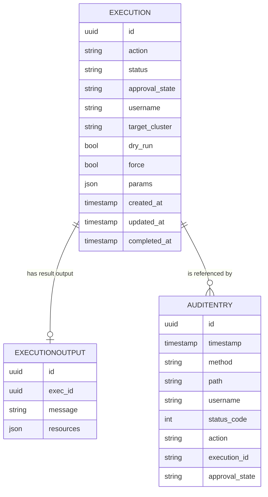
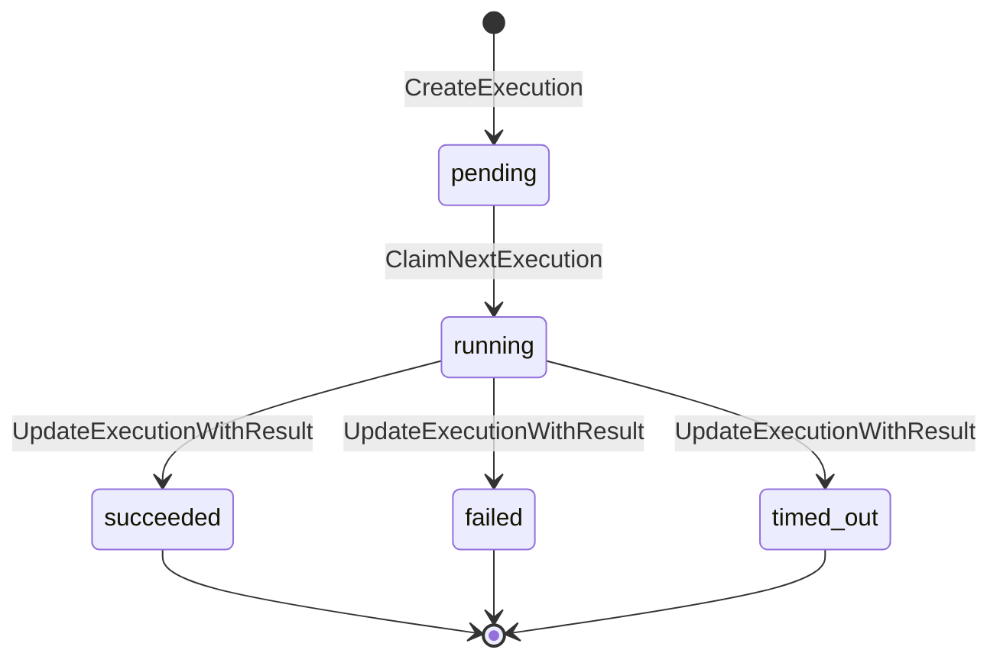

## Overview

The service persists two kinds of records: **executions** of Trusted Actions (the work items processed by the [execution pipeline](execution-pipeline.md)) and **audit entries** (one per API request, written by `middleware.NewAuditLogger`). Both are defined as plain Go structs in `internal/models` and are read/written through a single `store.Store` interface (`internal/store/store.go`) that is implemented twice — once for PostgreSQL (`internal/store/postgres.go`) and once for SQLite (`internal/store/sqlite.go`) — so the rest of the application never depends on a specific database.

## Entity model


Executions own at most one output row (replaced on retry) and may be referenced by many audit entries via `execution_id`.

## Models (`internal/models`)

### Execution

`models.Execution` (`internal/models/execution.go`) is the row-level representation of one Trusted Action run:

- **Identity/targeting**: `ID` (UUID), `Action`, `TargetCluster`, `Username`, `Jira`.
- **Lifecycle**: `Status` is one of `pending`, `running`, `succeeded`, `failed`, `timed_out` (from `openapi.ExecutionStatus`). `ApprovalState` is one of `not_required`, `pending`, `approved`, `rejected` (`openapi.ApprovalState`) and is set to `not_required` by default when an execution is created from a request (`ExecutionFromRequest`).
- **Execution options**: `DryRun` and `Force`, both optional booleans echoed from the request and consumed by the execution pipeline.
- **Action metadata**: `Params` (raw JSON of action parameters), `Scope`, `Type`, `Revision`.
- **Forward-looking fields, not yet implemented by any writer**: `ManifestWorkName`, `RunnerSeconds`, `UploadSeconds`. These columns exist in the schema and are scanned/returned through the API, but nothing in the current codebase populates them — they are reserved for a future runner that reports ManifestWork-based execution and upload timing.
- **Timing**: `DurationSeconds`, `CreatedAt`, `UpdatedAt`, `CompletedAt`.

`ExecutionFromRequest` builds a new `Execution` from an incoming `openapi.ExecutionRequest`, always starting in `pending` status with a fresh UUID and `CreatedAt`/`UpdatedAt` set to now. `ToOpenAPI` converts a model back into the public `openapi.Execution` shape, decoding `Params` back into a string map and translating the optional enum pointers.

### AuditEntry

`models.AuditEntry` (`internal/models/audit.go`) records one HTTP request: `ID`, `Timestamp`, `Method`, `Path`, `Username`, `StatusCode`, plus optional request-derived context fields `Action`, `ExecutionID`, `Jira`, `ApprovalState`, `TargetCluster`. `ToOpenAPI` maps it directly to `openapi.AuditEntry`.

### ExecutionOutput

`models.ExecutionOutput` (`internal/models/output.go`) holds the result of a completed execution: a human-readable `Message` and a list of `Resources` (arbitrary JSON objects, typically the Kubernetes resources an action touched or deleted). `OutputFromActionResult` builds one from an `actions.ActionResult`, normalizing a `nil` `Resources` slice to an empty list so delete-style actions still serialize as `[]` rather than `null`. See [Execution Pipeline](execution-pipeline.md) for how actions produce `ActionResult`.

## The Store interface

`store.Store` (`internal/store/store.go`) is the single persistence abstraction used by the API handlers, the execution worker, and the audit middleware:

```go
type Store interface {
    CreateExecution(ctx, exec *models.Execution) error
    GetExecution(ctx, id uuid.UUID) (*models.Execution, error)
    GetExecutionOutput(ctx, execId uuid.UUID) (*models.ExecutionOutput, error)
    ListExecutions(ctx, filter ExecutionFilter) (*ExecutionListResult, error)
    UpdateExecutionWithResult(ctx, id uuid.UUID, status string, completedAt *time.Time, output *models.ExecutionOutput) error
    ClaimNextExecution(ctx) (*models.Execution, error)

    CreateAuditEntry(ctx, entry *models.AuditEntry) error
    ListAuditEntries(ctx, filter AuditFilter) (*AuditListResult, error)

    Close() error
}
```

- `CreateExecution` inserts a new execution row (status `pending`).
- `GetExecution` / `GetExecutionOutput` fetch a single execution or its result by ID, returning the shared `store.ErrNotFound` sentinel when absent.
- `ListExecutions` / `ListAuditEntries` apply an `ExecutionFilter`/`AuditFilter` (status, action, target cluster, operator, scope, type, approval state, dry-run/force, a `Since` timestamp, and limit/offset paging) and return paged results plus a total count.
- `UpdateExecutionWithResult` transitions an execution to a terminal status (`succeeded`/`failed`/`timed_out`), stamps `completed_at`, and atomically replaces any prior `ExecutionOutput` row for that execution inside one transaction — the old output row is deleted and a new one inserted only if `output` is non-nil, so retried or re-run executions never accumulate stale output rows.
- `ClaimNextExecution` is the worker-facing dequeue operation (see below).
<!-- openwiki: broken internal link [#audit-entries-vs-execution-records] heading anchor "audit-entries-vs-execution-records" does not exist in /openwiki/concepts/data-model-and-persistence.md. Fix the href or restore the target, then delete this comment. -->
- `CreateAuditEntry` / `ListAuditEntries` back the per-request audit log written by `middleware.NewAuditLogger`, distinct from execution lifecycle tracking (see [Audit entries vs. execution records](#audit-entries-vs-execution-records)).

### Backend selection: `store.New`

```go
func New(ctx context.Context, databaseURL string, cfg PostgresConfig, logger *logrus.Logger) (Store, error)
```

`store.New` dispatches purely on the `DATABASE_URL` scheme: if the URL starts with `postgres://` or `postgresql://` it opens a `PostgresStore`; any other value — including an empty string — falls back to `SQLiteStore`. This makes PostgreSQL opt-in and SQLite the zero-configuration default for local development and tests.

## Backend implementations

### PostgresStore

`NewPostgresStore` (`internal/store/postgres.go`) opens a connection pool via `sqlx`/`pgx`, applies `PostgresConfig` pool tuning (`MaxOpenConns`, `MaxIdleConns`, `ConnMaxLifetime`), pings the database, and runs migrations before returning. It is intended for production deployments (e.g. AWS RDS/Aurora) and supports genuine connection concurrency.

### SQLiteStore

`NewSQLiteStore` (`internal/store/sqlite.go`) opens a `modernc.org/sqlite` database (defaulting to the local file `trusted_actions.db` with a startup warning if `DATABASE_URL` is unset), enables WAL journaling, foreign keys, and a busy timeout, then runs migrations. Critically, it calls `db.SetMaxOpenConns(1)`: SQLite only tolerates one writer at a time, and a single shared connection both avoids "database is locked" errors on file-backed databases and prevents an `:memory:` database from being silently split across pool connections (each of which would otherwise see an empty, independent database). SQLite is intended for local development and testing, not production.

Because SQLite's native column type for timestamps is `TEXT`, `SQLiteStore` formats every `time.Time` using the fixed-width layout `timeLayout = "2006-01-02T15:04:05.000000000Z07:00"` before writing it, so that lexical `TEXT` comparisons (used for ordering and range filters) sort identically to chronological order. `PostgresStore` instead stores `TIMESTAMPTZ` natively and lets Postgres compare timestamps directly.

## Shared column lists and WHERE-clause builders (`shared.go`)

`internal/store/shared.go` centralizes the parts of the two backends' SQL that would otherwise drift out of sync:

- `executionColumns`, `outputColumns`, and `auditColumns` are the canonical, ordered column lists used in every `SELECT`/`INSERT` on both backends. Their order must match the field order of the corresponding `*Row` struct (`pgExecutionRow`/`sqliteExecutionRow`, etc.) because rows are scanned positionally with `sqlx`'s `StructScan`.
- `buildExecutionWhere(filter ExecutionFilter)` and `buildAuditWhere(filter AuditFilter)` build the common `WHERE` clause fragments (status, action, target, operator, scope, type, approval state, dry-run, force / method) shared by both stores, using `?` placeholders. Postgres queries call `db.Rebind` on the final query string to convert `?` into `$1, $2, …` before execution; SQLite queries use `?` as-is.

**Since-filter caveat**: `buildExecutionWhere` and `buildAuditWhere` deliberately exclude the `Since` filter. Each store appends its own `created_at >= ?` / `timestamp >= ?` clause after calling the shared builder, because the value must be formatted differently per backend — `filter.Since.UTC()` as a native `time.Time` for Postgres, versus `filter.Since.UTC().Format(timeLayout)` as a string for SQLite. Mixing these up (e.g. reusing a Postgres-formatted value against SQLite's `TEXT` column) would silently produce incorrect comparisons, so this logic cannot be shared and is intentionally duplicated in `postgres.go` and `sqlite.go`.

Paging helpers `clampLimit(v, defaultVal, max)` and `clampOffset(v)` (defined in `sqlite.go`, used by both stores) normalize list-query `Limit`/`Offset` inputs: executions default to a limit of 20 (max 100), audit entries default to 50 (max 200).

## Migrations

`internal/store/migrations.go` embeds two independent migration trees via `//go:embed migrations/sqlite migrations/postgres`, one per dialect, each containing paired `NNN_name.up.sql` / `NNN_name.down.sql` files (currently `001_init`). Applied versions are tracked in a `schema_migrations(version, applied_at)` table created on demand.

`runMigrations(ctx, db, dialect)` is called from both `NewPostgresStore` and `NewSQLiteStore` immediately after the initial ping:

1. For Postgres only, it acquires a session-level advisory lock (`pg_advisory_lock`, fixed key `0x526F7361`) on a dedicated connection before touching any migration, and releases it (`pg_advisory_unlock`) via `context.Background()` on return — using a background context (rather than the possibly-cancelled request context) ensures the unlock always runs even if the caller's context was cancelled during a shutdown, so the lock does not linger until `ConnMaxLifetime` expires. This serializes migration application across multiple concurrently starting server replicas; SQLite needs no equivalent lock since each process owns its own file and `SetMaxOpenConns(1)` already serializes access.
2. It ensures the `schema_migrations` table exists, lists `*.up.sql` files for the dialect in sorted order, and for each one not already recorded: reads the embedded SQL, executes it and inserts a `schema_migrations` row in a single transaction, then commits.

`rollbackMigration`/`RollbackLastMigration` provide the inverse operation (used by maintenance tooling, not application startup): they look up the most recently applied version, execute its paired `.down.sql` file, and delete the `schema_migrations` row, all inside one transaction.

The `001_init` migration creates three tables mirroring the Go models — `executions`, `executions_output` (foreign-keyed to `executions.id`), and `audit_entries` (also foreign-keyed to `executions.id` via `execution_id`) — plus supporting indexes on `status`, `action`, `target_cluster`, `username`, `created_at`/`timestamp`, and a composite `(status, created_at)` index on `executions` that backs `ClaimNextExecution`'s ordered pending-row scan. The SQLite and Postgres versions of this migration are schema-equivalent but use dialect-appropriate column types (`TEXT`/`INTEGER` timestamps and booleans for SQLite vs. `TIMESTAMPTZ`/`BOOLEAN` for Postgres).

## ClaimNextExecution: atomic work claiming

`ClaimNextExecution` is the mechanism the execution worker uses to dequeue the next pending execution (see [Execution Pipeline](execution-pipeline.md) for the worker loop that calls it). It must guarantee that exactly one worker transitions any given execution from `pending` to `running`, even when multiple worker instances poll concurrently.

- **PostgresStore**: runs `SELECT id FROM executions WHERE status = 'pending' ORDER BY created_at ASC, id ASC LIMIT 1 FOR UPDATE SKIP LOCKED` inside a transaction. `FOR UPDATE` takes a row lock on the selected pending execution; `SKIP LOCKED` means a concurrent worker that reaches the same query while another worker's claim transaction is still open simply skips that row and locks the next pending one instead, rather than blocking. This is the idiomatic Postgres queue-claiming pattern: it scales to many concurrent workers because each transaction only ever locks the single row it claims, never the whole table.
- **SQLiteStore**: runs the equivalent `SELECT ... LIMIT 1` plus `UPDATE ... SET status = 'running'` inside a transaction, but safety against concurrent claims here comes from `SetMaxOpenConns(1)` on the underlying `*sql.DB`: because the connection pool allows only one open connection, SQLite itself serializes all transactions process-wide, so two claims can never interleave even without `FOR UPDATE SKIP LOCKED` (which SQLite does not support).

Both implementations: select the oldest pending execution ordered by `created_at ASC, id ASC` (FIFO, with ID as a tiebreaker for identical timestamps), update its `status` to `running` and `updated_at` to now, re-select the full row, and commit — returning `store.ErrNotFound` if no pending execution exists, which callers treat as "nothing to do right now" rather than an error.

### Execution audit trail vs. request-level audit entries

`ClaimNextExecution` and `UpdateExecutionWithResult` mutate the single source of truth for an execution's lifecycle state (the `executions` row itself — there is no separate execution-history table). This is distinct from the request-level audit log: `middleware.NewAuditLogger` wraps every HTTP request and, after the handler completes, writes one `AuditEntry` row via `CreateAuditEntry` capturing the method, path, response status, caller identity, and any `AuditContext` fields (`ExecutionID`, `Jira`, `ApprovalState`, `TargetCluster`) the handler attached to the request context via `middleware.SetAuditContext`. Audit entries are therefore an independent, append-only record of *who called which endpoint and when*, while an execution's `status`/`approval_state` columns reflect only its *current* lifecycle state — reconstructing an execution's full history requires joining `audit_entries.execution_id` back to the executions it refers to, since there is no dedicated status-history table.

## Execution status and approval-state lifecycle

An execution's `status` moves `pending` → `running` → one of `succeeded` / `failed` / `timed_out`:


Execution status transitions driven by the Store API; approval_state (not_required/pending/approved/rejected) is tracked independently and gates whether an execution is eligible to run at all.

`approval_state` is a parallel, independently tracked field (`not_required`, `pending`, `approved`, `rejected`) set at creation time by `ExecutionFromRequest` and used by the approval workflow described in [Executing a Trusted Action](../workflows/executing-a-trusted-action.md) to gate whether a `pending` execution is eligible to be claimed and run at all.

## Related pages

- [Execution Pipeline](execution-pipeline.md) — how the worker loop uses `ClaimNextExecution` and `UpdateExecutionWithResult`, and how `ActionResult` becomes `ExecutionOutput`.
- [API Surface](../architecture/api-surface.md) — the HTTP endpoints backed by `ListExecutions`, `GetExecution`, `GetExecutionOutput`, and `ListAuditEntries`.
- [Executing a Trusted Action](../workflows/executing-a-trusted-action.md) — the end-to-end request flow that creates, approves, and runs an execution.
- [Testing Strategy](../testing/testing-strategy.md) — how the Postgres and SQLite store implementations are tested against a shared behavioral suite.
