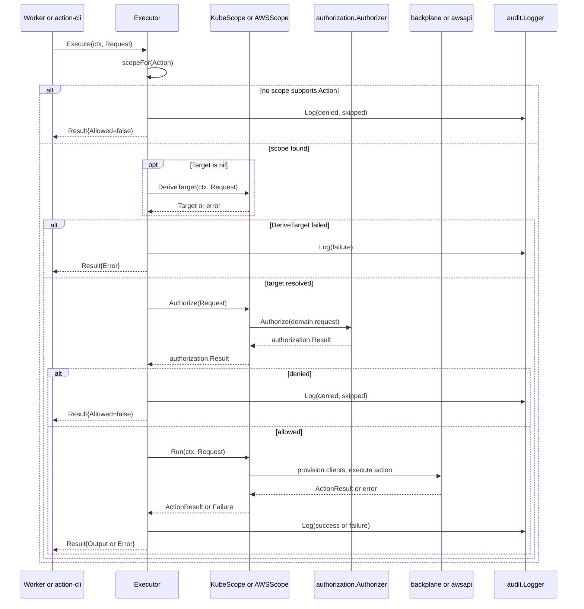

## Overview

`internal/executor` is the engine that authorizes and runs a single trusted
action. It knows nothing about HTTP: it is driven by `cmd/server`'s background
worker pool for API-submitted executions, and equally by `cmd/action-cli` for
local, synchronous runs. Both callers build the same `executor.Request`,
hand it to the same `*Executor.Execute`, and get back the same `*Result`.

The package's central idea is the **Scope**: one execution domain — the
Kubernetes API of a managed cluster, or an AWS account — that owns everything
domain-specific about running an action: which actions belong to it, how a
target is derived and authorized, and how the clients an action needs are
provisioned. `Executor` itself stays domain-agnostic and simply dispatches to
whichever registered `Scope` claims the requested action.

## Request, Target, Result, Failure

```go
type Request struct {
    CallerID       string
    ClusterID      string
    ClusterVersion string
    Action         actions.Action
    Target         actions.Target // nil => the scope derives it from Params
    Params         map[string]string
}

type Result struct {
    Allowed bool
    Reason  string
    Output  *actions.ActionResult
    Error   error
}
```

- `actions.Target` is a marker interface (`isTarget()`) implemented by each
  scope's own target type — `actions.ResourceTarget` for Kubernetes and
  `actions.AWSTarget` for AWS — so an `executor.Request` can only ever carry a
  target that some scope actually understands.
- A `Request` normally leaves `Target` nil; the scope that will run the action
  fills it in from `Params` via `DeriveTarget`. `cmd/action-cli` and
  `internal/worker`'s `ExecutorRunner` both rely on this and never construct a
  target themselves for params-driven invocations (the CLI does build an
  explicit `ResourceTarget` from flags when it already knows the full
  coordinates).
- `Result.Allowed` and `Result.Error` are independent: a request can be denied
  with no error (authorization worked and said no), or can fail with no denial
  (authorization passed but `DeriveTarget`/`Run` hit a problem). Callers must
  check `Error` before treating a non-`Allowed` result as a denial, exactly as
  `worker.ExecutorRunner.Run` does.

`Failure` is how a `Scope` reports a stage failure in `DeriveTarget` or `Run`:

```go
type Failure struct {
    Message string
    Cause   error
}
```

`Failure.Message` is the caller-facing framing ("failed to resolve the
cluster's AWS region", "failed to get cluster client"); `Failure.Cause` is the
underlying error. `Failure.Error()` concatenates both for anyone just logging
the error, but `Executor.Execute` deliberately unwraps `Cause` (via
`auditedCause`) before writing `rec.Error`, so the audit trail records the
underlying technical cause rather than the pipeline's caller-facing wording.
A plain (non-`Failure`) error from `DeriveTarget`, such as `AWSScope` refusing
a mismatched resource, means the request was understood and refused rather
than something failing — see below.

## The Scope interface

```go
type Scope interface {
    Supports(action actions.Action) bool
    DeriveTarget(ctx context.Context, req Request) (actions.Target, error)
    Authorize(req Request) authorization.Result
    Run(ctx context.Context, req Request) (*actions.ActionResult, error)
}
```

- **Supports** — a cheap type assertion against the action's scope-specific
  subtype (`actions.KubeAction` for `KubeScope`, `actions.AWSAction` for
  `AWSScope`). `Executor.scopeFor` walks the registered scopes in order and
  returns the first one whose `Supports` matches.
- **DeriveTarget** — fills in a target from `req.Params` when the caller left
  `Target` nil. It takes a `context.Context` and can fail, because filling in a
  default sometimes requires a lookup (AWS region/InfraID from OCM).
- **Authorize** — decides whether the request is permitted, given the
  (possibly just-derived) target. It never touches real backend clients.
- **Run** — provisions the clients the action needs (a backplane dynamic
  client, an AWS SDK client set) and executes it, translating provisioning or
  execution errors into `*Failure`.

Both `KubeScope` and `AWSScope` implement this interface
(`var _ Scope = (*KubeScope)(nil)` / `(*AWSScope)(nil)`), and nothing outside
`internal/executor` needs to know which concrete scope ran a given action.

## Executor.Execute flow

`Executor` holds a logger, an `audit.Logger`, and the ordered list of
registered `Scope`s (`executor.New(logger, auditor, scopes...)`). `Execute`
runs these steps, always writing exactly one `audit.Record` via a deferred
`auditor.Log(rec)`:

1. **Find a scope.** `scopeFor(req.Action)` returns the first `Scope` whose
   `Supports` matches. If none does, the record is marked
   `DecisionDenied`/`OutcomeSkipped` and `Execute` returns immediately — an
   action registered in `internal/actions` but not claimed by any scope is
   denied, not run.
2. **DeriveTarget**, only if `req.Target == nil`. A `DeriveTarget` error is
   recorded as `OutcomeFailure` (not a denial): authorization never ran because
   there was nothing to authorize against, so the caller must not be told they
   were refused.
3. **Authorize.** The resolved target is attached to the audit record
   (`rec.Target`) before the call. A `false` result is recorded as
   `DecisionDenied`/`OutcomeSkipped`.
4. **Run.** Only reached once authorization passed (`rec.Decision =
   DecisionAllowed`). A `Run` error is recorded as `OutcomeFailure`; the result
   still reports `Allowed: true` because authorization did succeed — only
   execution failed.
5. **audit.Log.** The deferred call fires on every return path, so every
   invocation — skipped, denied, failed, or succeeded — produces exactly one
   `audit.Record` with a `Decision`, `Outcome`, and (for failures) the
   unwrapped `Error`.


*Call sequence of `Executor.Execute`: target derivation, authorization, run, and the single audit write on every path.*

## KubeScope

`KubeScope` runs `actions.KubeAction`s against the Kubernetes API of a managed
cluster, reaching it through a `backplane.ClientProvider`.

- **DeriveTarget** builds an `actions.ResourceTarget` purely from
  `req.Params` (`group`, `version`, `resource`, `name`, `namespace`) — it never
  fails and needs neither the context nor the rest of the request.
  `ClusterScoped` is deliberately **never** inferred from an absent namespace
  param. A previous version did this and it let a caller bypass the namespace
  allowlist entirely, because `authorization.Authorizer.Authorize`'s
  "namespace required" check never fires once `ClusterScoped` is `true`. Until
  cluster-scoped targets can be derived from something the caller doesn't
  control — e.g. action/resource metadata — every params-derived target is
  treated as namespaced.
- **Authorize** maps the target onto `authorization.Request{Namespace,
  ResourceType, ResourceName, ClusterScoped}` and delegates to the injected
  `authorization.Authorizer`, which enforces the namespace allowlist and, for
  `secrets`, a separate per-secret allowlist (see
  [Authorization Model](authorization-model.md)).
- **Run** asks the action for its `RequiredRBAC(target)` and opens a
  **backplane session scoped to exactly that RBAC** via
  `backplane.ClientProvider.GetClient(ctx, clusterID, actionName, rbacRules)`
  — least-privilege per action rather than one broad session reused across
  actions. If the action reports `UsesPodExec() == true`, `Run` additionally
  requests a `backplane.PodExecutor` scoped to the same RBAC rules and attaches
  it to `actions.KubeClients`; actions that don't exec into pods never pay for
  or receive one. `actions.KubeActionRequest{Target, ClusterVersion, Params}`
  is then passed to `action.Execute`.

## AWSScope

`AWSScope` runs `actions.AWSAction`s against the AWS API, reaching it through
credentials an `awsapi.ClientProvider` resolves for the target cluster's
account.

- **DeriveTarget** builds an `actions.AWSTarget{Region, Resource, ID}` from
  params, but **region always comes from `s.aws.DefaultRegion(ctx,
  req.ClusterID)`, never from the caller**: a cluster's AWS resources live
  where the cluster does, so honoring a caller-supplied region could only ever
  read an account the resolved credentials don't reach, or an unrelated corner
  of the one they do. The lookup happens here, inside `DeriveTarget`, rather
  than inside the client provider, so the region a request is authorized and
  audited against is the exact one the action runs in.
- For a plain (read) action, derivation stops there. For an
  `actions.AWSWriteAction`, two more things happen:
  - **Refusing a caller-supplied resource that doesn't match.** If
    `params["resource"]` is non-empty and differs from `write.Resource()`
    (the resource kind the write action itself declares), `DeriveTarget`
    returns a plain error — not a `Failure` — because nothing failed: the
    request was understood and refused, for the same reason `aws-get` refuses
    a param its resource doesn't accept. Quietly overriding the caller's named
    resource would be the worst possible way to correct a mismatched
    expectation about what is being changed. When no resource was supplied,
    `target.Resource` is set to `write.Resource()`.
  - **Resolving InfraID from OCM**, alongside the region
    (`s.aws.ClusterInfraID(ctx, req.ClusterID)`). This is what the action
    checks the target instance's ownership tag against before mutating it, so
    it must come from the cluster record, never the request; a lookup failure
    here is a `Failure` that stops execution, since an ownership check with
    nothing to compare against would not be a real check.
- **Authorize** builds an `authorization.AWSRequest{Region, Resource,
  Operation}` and delegates to `authorization.AWSAuthorizer`. `Operation` is
  **taken from the action** (`write.Operation()` for an `AWSWriteAction`, empty
  otherwise) rather than from the request params — letting the caller name
  their own operation would let them pick which allowlist entry judges them,
  e.g. describing a `terminate` as a `reboot`. An action that isn't a write is
  judged purely as a read (empty operation). See
  [Authorization Model](authorization-model.md) for how the region/operation
  allowlists are configured.
- **Run** asks the action for `RequiredServices(target)` and builds only those
  AWS SDK clients via `s.aws.GetClients(ctx, clusterID, region, services)` —
  the AWS analogue of `KubeScope`'s least-privilege RBAC scoping, so an
  execution never holds a client it has no reason to use. It then calls
  `action.Execute(ctx, clients, actions.AWSActionRequest{Target, Params})`.

See [AWS Integration](../integrations/aws.md) for how `awsapi.ClientProvider`
resolves per-cluster credentials, and
[Backplane Integration](../integrations/backplane.md) for how
`backplane.ClientProvider` opens cluster sessions.

## Every action belongs to exactly one scope

`internal/actions` registers actions by name independent of any scope
(`RegisterActionFactory`, `CreateAction`, `GetActionsNames`). Nothing in that
registration ties an action to a scope — that link exists only through the
action's Go type implementing `actions.KubeAction` or `actions.AWSAction`
(`Scope.Supports`). `TestScopes_CoverEveryRegisteredAction`
(`internal/executor/scope_test.go`) guards this: it builds an `Executor` wired
with one instance of every registered scope and asserts that
`exec.scopeFor(action)` is non-nil for every name `GetActionsNames` returns.
If an action is registered but no scope claims it, `Execute` doesn't error
loudly — it denies the request with "no execution scope configured for action"
(`DecisionDenied`/`OutcomeSkipped`), which would otherwise surface only as a
puzzling runtime denial. Consequently, **adding a new execution domain (a third
cloud provider, for example) means adding a new `Scope` implementation** and
wiring it into both `cmd/server`'s `executor.New(...)` call and
`cmd/action-cli`'s equivalent, not just adding new action types.

## Shared by worker and action-cli

- `cmd/server` constructs one `*executor.Executor` with both scopes
  (`executor.New(logger, actionAuditor, executor.NewKubeScope(...),
  executor.NewAWSScope(...))`) and hands it to
  `worker.NewExecutorRunner`, which `internal/worker`'s pool uses to run
  previously-queued executions off the HTTP request path — see
  [Executing a Trusted Action](../workflows/executing-a-trusted-action.md).
  `ExecutorRunner.Run` leaves `Request.Target` nil so the matched scope derives
  it from the execution's stored params, the same path `cmd/action-cli` uses.
- `cmd/action-cli` builds its own `*executor.Executor` locally — choosing
  `NewAWSScope` or `NewKubeScope` based on whether the resolved action is an
  `actions.AWSAction` — and calls `Execute` synchronously, printing the
  `Result` instead of persisting it. It reads the same environment variables
  the server does for allowlists (e.g. `ROSA_TA_AWS_ALLOWED_REGIONS`) so that
  what the CLI can exercise never exceeds what the server would actually
  permit.

Because both entrypoints go through the identical `Executor.Execute`, the
authorization and audit semantics described above hold regardless of whether
the action was submitted over the API and dequeued by the worker, or run
directly from a developer's machine via `action-cli`.
