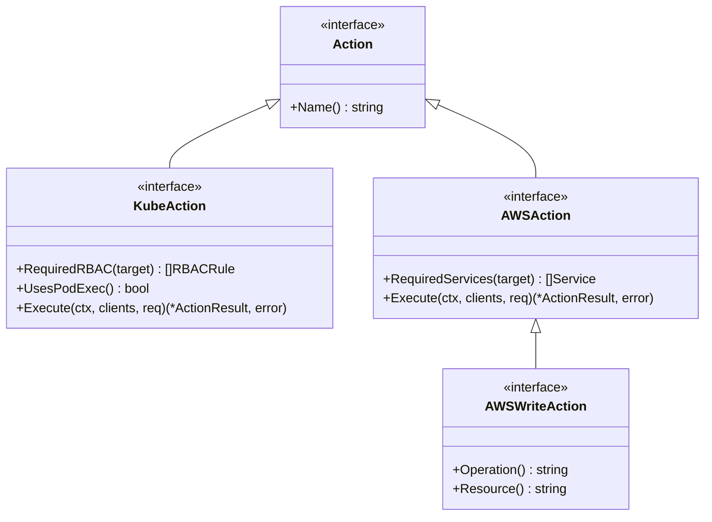
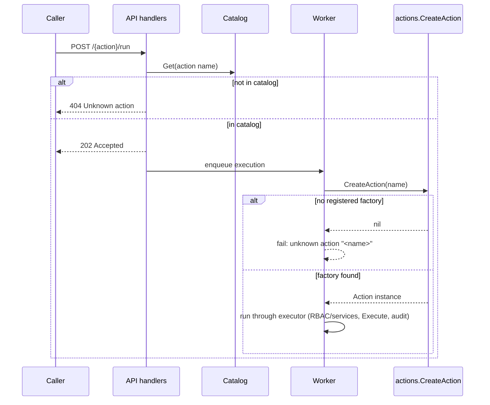

## What a Trusted Action is

A **Trusted Action** is a named, auditable operation that the server runs
against a managed cluster or cloud account on a caller's behalf. Callers never
talk to the cluster or AWS account directly: they submit an action through the
API, the server authorizes it, requests a least-privilege backplane (or AWS)
session scoped to exactly what the action declares it needs, runs it, and
records an audit entry. See
[Execution Pipeline](execution-pipeline.md) for how a request moves through
authorization, session provisioning, execution, and auditing, and
[Authorization Model](authorization-model.md) for how roles, namespace/secret
allowlists, and the AWS write allowlist gate execution.

Every action is defined in **two independent places**, both mandatory:

| Layer | File | Purpose |
|-------|------|---------|
| **Implementation** | `internal/actions/<name>.go` | What the action does and the exact RBAC/AWS services it needs. Implements the `actions.Action` interface and self-registers. |
| **Catalog (policy)** | `internal/catalog/catalog.go` | The public contract: action type, scope, allowed caller roles, parameters, and write-safety metadata. This is what the API exposes and validates against. |

## The `Action` interface family

`internal/actions/actions.go` defines a small interface hierarchy, split
between a scope-independent identity and two scope-specific execution
contracts:

```go
type Action interface {
    Name() string
}

type KubeAction interface {
    Action
    RequiredRBAC(target ResourceTarget) []backplane.RBACRule
    UsesPodExec() bool
    Execute(ctx context.Context, clients KubeClients, req KubeActionRequest) (*ActionResult, error)
}

type AWSAction interface {
    Action
    RequiredServices(target AWSTarget) []awsapi.Service
    Execute(ctx context.Context, clients awsapi.Clients, req AWSActionRequest) (*ActionResult, error)
}

type AWSWriteAction interface {
    AWSAction
    Operation() string
    Resource() string
}
```

- **`Action`** is deliberately minimal — just `Name()` — and has no `Execute`
  method. An action cannot be run without going through a scope
  (`KubeAction` or `AWSAction`), so execution always flows through the
  component that authorizes it and provisions its clients.
- **`KubeAction.RequiredRBAC(target)`** returns the least-privilege RBAC rules
  the executor needs for this specific target; the executor builds a
  backplane client scoped to exactly those rules and nothing more, and —
  only if `UsesPodExec()` returns `true` — also provisions a `PodExecutor`.
  The action never constructs its own cluster credentials.
- **`AWSAction.RequiredServices(target)`** is the AWS analogue of
  `RequiredRBAC`: it names only the AWS service clients (`awsapi.Service`
  values, e.g. EC2, ELB, ELBv2, Route53, CloudTrail) the scope should build
  for this execution.
- **`AWSWriteAction`** extends `AWSAction` with `Operation()` and
  `Resource()`. These exist to close two separate holes that `AWSAction`
  alone leaves open:
  - **Write-allowlist enforcement.** `AWSScope.Authorize` (in
    `internal/executor/aws.go`) derives the operation to authorize purely
    from a type assertion to `AWSWriteAction`. If a mutating action
    implements only `AWSAction`, the scope treats it as a read and never
    consults `ROSA_TA_AWS_ALLOWED_OPERATIONS` /
    `actions.aws_allowed_operations` at all — it runs unconditionally. When
    an action does implement `AWSWriteAction`, `Operation()` names the
    mutation (e.g. `"reboot"`, `"terminate"`) and that value, taken from the
    action rather than the request, is what the allowlist is checked
    against. A caller cannot describe a terminate as a reboot to land on a
    permitted entry.
  - **Resource redirection prevention.** `Resource()` fixes the kind of
    object the write acts on. A read action lets the caller name the
    `resource` param freely because listing the wrong kind is harmless; a
    write action must not, or `"terminate"` would mean whatever the caller
    decided it meant. `AWSScope.DeriveTarget` refuses a request whose
    caller-supplied `resource` param disagrees with `write.Resource()`
    rather than silently overriding it, and otherwise pins the target's
    resource to the action's declared one.
  - Catalog `Type: openapi.Write` alone does **not** enforce either of
    these — it is descriptive metadata, never cross-checked against the Go
    interface the action actually implements. Getting `AWSWriteAction`
    right is entirely the implementation's responsibility.



## `ActionResult` and output shaping

Both `KubeAction.Execute` and `AWSAction.Execute` return the same
scope-independent `*ActionResult`:

```go
type ActionResult struct {
    Resources []map[string]interface{}
    Message   string
}
```

`Resources` carries zero or more objects as plain maps, and `Message` is a
short human-readable summary (e.g. `"got pods/foo in bar"`,
`"requested reboot of i-0123 in us-east-1"`) that is stored alongside the
execution record. Two helpers in `actions.go` build `Resources` for each
scope:

- **`resourcesFrom(objects ...unstructured.Unstructured)`** converts
  Kubernetes `unstructured.Unstructured` objects into `[]map[string]interface{}`
  by taking their already-map-shaped `.Object` field directly — no
  marshaling is needed because unstructured objects are maps already.
- **`awsResourcesFrom[T any](objects []T)`** converts AWS SDK structs (which
  carry no JSON tags) into the same representation by round-tripping each
  object through `json.Marshal`/`json.Unmarshal`. Keys come out as the AWS
  API's own field names (`InstanceId`, `State`, ...), matching what the AWS
  CLI prints. After unmarshaling, it calls **`pruneUnset`**, which deletes
  every nil-valued key recursively from maps (but not from list elements,
  where a missing entry is left as `null` rather than silently shifting
  positions) so a caller sees only the fields AWS actually set instead of a
  wall of nulls for every field the SDK struct happens to declare.

## Registration: `RegisterActionFactory` / `CreateAction`

Actions self-register at package-load time via `init()`:

```go
func init() {
    RegisterActionFactory(NewGetPullSecretEmailAction)
}
```

`RegisterActionFactory[A Action](factory func() A)` stores a factory —
not a shared instance — keyed by the action's `Name()`, so every execution
gets a fresh value with no state carried over from a previous run. The
worker and `cmd/action-cli` both resolve an action by name through
`CreateAction(actionName string) Action`, which looks up the factory and
invokes it, returning `nil` if no action registered under that name. All
`internal/actions/*.go` `init()` functions run the moment the
`internal/actions` package is imported — compiled into the single server
binary, not loaded dynamically — so every action in the repository is live
in every build; there is no per-deployment action toggle at this layer
(role and allowlist policy is what actually restricts what runs, see
below). `GetActionsNames()` returns the sorted list of every registered
action name, used for diagnostics and for validating that the catalog and
registry agree.

## The catalog: policy independent of implementation

`internal/catalog/catalog.go` defines `ActionDefinition`, the policy record
for one action, and `Catalog`, the ordered collection of them built once by
`catalog.New()`:

```go
type ActionDefinition struct {
    Name                 string
    Description          string
    Type                 openapi.ActionType   // openapi.Read or openapi.Write
    Scope                openapi.Scope        // openapi.KubeApi or openapi.AwsApi
    AllowedRoles         []string
    Params               []ParamDefinition
    DryRunAction         string
    WriteCooldownSeconds int
    Approval             string
}
```

- **`Type`** (`Read`/`Write`) drives client expectations and auditing; it
  must honestly reflect whether the action mutates state, but — as noted
  above — it is never cross-checked against whether the Go type actually
  implements `AWSWriteAction`.
- **`Scope`** (`KubeApi`/`AwsApi`) says which execution scope
  (`internal/executor`) runs the action.
- **`AllowedRoles`** lists the caller roles permitted to invoke the action;
  the authorization layer rejects callers whose role is not listed. Most
  actions grant the catalog's `allRoles` convenience slice (`SREP`,
  `ConfigurationAnomalyDetection`, `ROSAAiAgent`), but higher-risk actions
  narrow this — `aws-terminate` is restricted to `SREP` alone because it is
  irreversible.
- **`Params`** documents each parameter's name, description, whether it is
  `Required`, and its `Default`. This is descriptive, surfaced through
  `GET /{action}` for callers — the API does not reject a request for
  omitting a required param at submission time; a missing param still
  returns `202` and only fails once `Execute` runs, so each action must
  validate its own parameters.
- **Write-safety metadata** — `DryRunAction` (a read-only counterpart to run
  instead when a dry run is requested), `WriteCooldownSeconds` (throttles
  repeat mutations), and `Approval` (records an approval requirement, e.g.
  `"manual"`) — applies to `Type: openapi.Write` actions.

`Catalog` exposes lookups used elsewhere in the system: `GetAction` adapts an
`ActionDefinition` into the narrower `auth.Action` shape the authorization
package depends on (`Catalog` implements `auth.ActionCatalog`), `Get`/`All`
serve the handler layer, and `ToOpenAPISummary`/`ToOpenAPIDetail` render the
definition into the OpenAPI types returned by `GET /` and `GET /{action}`
(see [API Surface](../architecture/api-surface.md)).

## Why both registrations are mandatory

The implementation registry and the catalog are deliberately independent, so
the public contract (catalog) can be reviewed separately from the behavior
(implementation). Registering only one half leaves the system in a broken,
asymmetric state:

- **Catalog entry without an implementation** — the API accepts
  `POST /{action}/run` because the catalog says the action exists, but the
  background worker fails the execution with `unknown action "<name>"` when
  it calls `actions.CreateAction` and gets `nil` back.
- **Implementation without a catalog entry** — `GET /{action}` and
  `POST /{action}/run` both return `404 Unknown action`, because the API
  handlers validate every request against the catalog before the registry
  is ever consulted. The action is compiled in and registered, but entirely
  unreachable through the API.

See [Adding a Trusted Action](../workflows/adding-a-trusted-action.md) for the
step-by-step procedure, review requirements, and the runtime validations
(namespace allowlist, secret allowlist, cluster-scoped target handling) that
also gate whether a newly added action can actually run in a given
environment.



## Survey of existing actions

The registry spans both Kubernetes-scoped and AWS-scoped actions, read and
write alike:

**Kubernetes actions** (`Scope: openapi.KubeApi`):

- **`get`** — generic get-or-list for any resource identified by
  `group`/`version`/`resource`/`namespace`/`name`; lists when `name` is
  empty, gets a single named object otherwise. The RBAC it requests narrows
  accordingly (`list` with no `ResourceNames` vs. `get` with
  `ResourceNames`).
- **`patch`** — applies a JSON merge patch to a single named resource
  (`internal/actions/patch.go`); a write action.
- **`delete`** — deletes a single named resource
  (`internal/actions/delete.go`); a write action.
- **`describe-nodes`** — a composite read that correlates node data with
  pods, events, and lease information, switching between a named-target and
  a list-all RBAC shape depending on whether a node name is given.
- **`get-pull-secret-email`** — a narrow, bespoke read that fetches a single
  field (the registered email) out of the cluster pull secret, requesting
  only `get` on that one named secret.
- **`list-alerts`** — reaches into a cluster pod via `UsesPodExec()` to
  query Prometheus/Alertmanager (via `wget` inside the pod) for firing or
  pending alerts and, optionally, active silences; it is the reference
  pod-exec action and validates its `severity`/`state` params at the
  boundary.

**AWS actions** (`Scope: openapi.AwsApi`):

- **`aws-get`** — a single generic read action covering many AWS resource
  types (EC2 instances, security groups, subnets, route tables, VPCs, DHCP
  options, classic and v2 load balancers, target groups, target health,
  CloudTrail events, Route53 hosted zones and record sets). Internally,
  `aws_ec2.go`, `aws_elb.go`, `aws_route53.go`, and `aws_cloudtrail.go` each
  contribute `describe` functions registered in one `awsResources` table in
  `aws_get.go`; each entry declares which single AWS service client it
  needs, whether it supports/requires/forbids a target `id`, and which extra
  params it accepts — unknown params are rejected outright rather than
  silently ignored.
- **`aws-reboot`** and **`aws-terminate`** — the two AWS write actions
  (`internal/actions/aws_write.go`), both acting only on EC2 instances
  (`Resource()` returns the fixed `"ec2-instances"` constant, matching the
  resource name `aws-get` uses for the same objects). Before mutating
  anything, both call `requireClusterInstance`, which describes the target
  instance and refuses to proceed unless it carries the target cluster's
  `kubernetes.io/cluster/<infraID>=owned` tag — this is what keeps a write
  action's blast radius to the one cluster whose session obtained the
  credentials, rather than every instance reachable in the shared AWS
  account. `aws-terminate` is additionally restricted to the `SREP` role in
  the catalog because it is irreversible.

This is not an exhaustive list of every parameter or resource type — see
`internal/actions/aws_get.go`'s `awsResources` table and each action's own
file for the full surface — but it illustrates the breadth: most Kubernetes
actions are either the three generic CRUD primitives (`get`/`patch`/`delete`)
or small bespoke reads, while the AWS surface is concentrated in one broad
generic reader (`aws-get`) plus a pair of narrow, ownership-checked writes.
