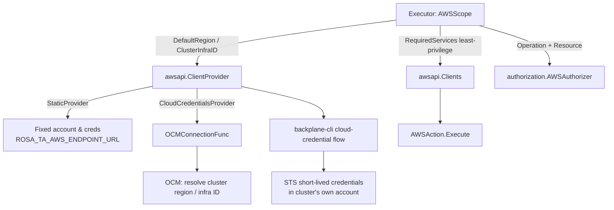

## Overview

AWS integration lives in two layers. `internal/awsapi` is the AWS counterpart
of `internal/backplane` (see [Backplane Integration](backplane.md)): it is
responsible for turning a cluster ID into a set of concrete AWS service
clients, deciding *which* account and credentials to use. `internal/actions`
(`aws_get.go`, `aws_write.go`, `aws_ec2.go`, `aws_elb.go`, `aws_route53.go`,
`aws_cloudtrail.go`) declares what the actions do with those clients, and
which AWS clients each one actually needs. `internal/executor/aws.go`'s
`AWSScope` is the glue: it resolves the target region and infrastructure ID,
authorizes the request, asks the `ClientProvider` for only the clients the
action named, and runs the action against them. See
[Execution Pipeline](../concepts/execution-pipeline.md) for how `AWSScope`
fits among the other scopes.



## The AWSAction / AWSWriteAction contract

Every AWS action implements `actions.AWSAction`
(`RequiredServices(target) []awsapi.Service` plus
`Execute(ctx, clients awsapi.Clients, req AWSActionRequest)`). `RequiredServices`
is the AWS analog of `KubeAction.RequiredRBAC`: it lets the action declare, per
target, exactly which `awsapi.Service` values (`ec2`, `elb`, `elbv2`,
`cloudtrail`, `route53`) it needs, so `AWSScope.Run` asks the provider to build
only those clients rather than every supported client on every execution. A
read like `aws-get` looks up its resource descriptor and returns a single
service; `aws-reboot` and `aws-terminate` both return only `ServiceEC2`,
because the ownership check they perform (`DescribeInstances`) and the mutation
itself are both EC2 calls — a write needs no client a read does not already
have.

Mutating actions additionally implement `actions.AWSWriteAction`, adding two
methods the scope cannot otherwise work out:

- **`Operation() string`** — one of the `AWSOperationReboot` /
  `AWSOperationTerminate` constants. It names the mutation the way
  `authorization.AWSAuthorizer`'s write allowlist is configured, and it comes
  from the action, never the request, so a caller cannot describe a terminate
  as a reboot to land on a permitted allowlist entry, or omit it to be judged
  as a read.
- **`Resource() string`** — fixes the object kind acted on
  (`ec2-instances` for both current write actions). A read lets the caller name
  a resource freely because listing the wrong kind is harmless; a write must
  not, so `AWSScope.DeriveTarget` rejects a request whose `resource` param
  disagrees with what the action itself declares, rather than overriding it
  silently.

`authorization.AWSAuthorizer.Authorize` enforces two independent gates read
from `authorization.AWSPolicy`:

1. **Region allowlist** (`AllowedRegions`) — applies to every AWS request, read
   or write. It defaults to empty, i.e. deny-all; there is no built-in default
   region, so a deployment that configures nothing can reach no region at all.
2. **Operation allowlist** (`AllowedOperations`) — checked only when
   `req.Operation` is non-empty, i.e. only for writes. It also defaults to
   empty: an unconfigured server can read AWS but cannot mutate it. An operator
   enables `reboot` and/or `terminate` explicitly, one at a time.

Both allowlists fail closed: an empty list denies rather than permits, unlike
the Kubernetes authorizer's permissive mode. Besides the allowlists,
`aws_write.go`'s `requireClusterInstance` enforces per-instance ownership: it
describes the target instance and refuses unless it carries the
`kubernetes.io/cluster/<infraID>=owned` tag — the same tag
configuration-anomaly-detection uses to recognize a cluster's own instances.
This is what keeps a write's blast radius to the cluster rather than the whole
AWS account the credentials can reach (in a ROSA account, that can include
other clusters and the customer's own workloads). A missing `InfraID` on the
target — the case when a provider cannot resolve one — makes the check refuse
outright: an ownership check that cannot run has not passed.

## awsapi.ClientProvider

```go
type ClientProvider interface {
    DefaultRegion(ctx context.Context, clusterID string) (string, error)
    ClusterInfraID(ctx context.Context, clusterID string) (string, error)
    GetClients(ctx context.Context, clusterID, region string, services []Service) (Clients, error)
}
```

`AWSScope.DeriveTarget` calls `DefaultRegion` before authorization runs, so the
region a request is judged and audited against is the region it actually
executes in — callers never name a region themselves; a `region` param is
rejected like any other unrecognized one. For write actions, `DeriveTarget`
also calls `ClusterInfraID` and stores it on the `AWSTarget`, since that is
what `requireClusterInstance` later checks the instance's ownership tag
against. Both methods return an empty string without an error when the
provider simply has no answer — callers must treat that as "unproven" (writes
refuse, reads with no region configured are denied by the authorizer) rather
than as permission to proceed.

`buildClients` is the single switch statement, shared by both providers, that
turns a `[]Service` plus one `aws.Config` into a populated `awsapi.Clients`
struct. Routing every provider through it means adding a new `Service` cannot
leave one provider silently handing an action a nil client for it — that bug
would otherwise only surface when the action's code dereferenced the nil field.

### StaticProvider — fixed account, for local/emulator use

`awsapi.StaticProvider` builds every client from one fixed `StaticConfig`
(region, static access key/secret/session token, and an `EndpointURL`
override), ignoring `clusterID` entirely: every execution reaches the same
account no matter which cluster is named. `cmd/server/main.go` selects it
exactly when `ROSA_TA_AWS_ENDPOINT_URL` is set — an endpoint override can only
sensibly mean a local emulator such as LocalStack, so that single setting also
picks the provider. It also carries a single configured `InfraID`, since this
provider has no OCM to resolve one from per cluster; leaving it unset means
ownership can never be proven and every write is refused. `cmd/server/main.go`
logs a loud warning when this provider is selected, and the integration test
harness is the main consumer: `integration/itest-run.sh` exports
`ROSA_TA_AWS_ENDPOINT_URL=$LOCALSTACK_URL` to run `aws-get` reads against a
disposable LocalStack container. This provider must never be pointed at real
AWS in production — it offers no per-cluster isolation.

### CloudCredentialsProvider — per-cluster short-lived credentials

`awsapi.CloudCredentialsProvider` is the production path. For a given
`clusterID` it:

1. Resolves the cluster record via `ClusterResolver.Get` (satisfied by
   `internal/ocm.Clusters`; see [OCM Integration](ocm.md)), cached for
   `ClusterCacheTTL` (default 5 minutes) because `DefaultRegion` and
   `ClusterInfraID` are both consulted per execution and neither field
   (region, cloud provider) changes over a cluster's life.
2. Confirms the cluster's cloud provider is `aws` — a confusing type assertion
   failure is caught here with a clear error instead.
3. Calls `backplane-cli`'s `bpcloud.QueryConfig.GetCloudCredentials`, handing
   it the cluster and a live OCM connection. This walks the SRE assume-role
   chain from the payer account into the customer's own AWS account, mirroring
   what configuration-anomaly-detection's `pkg/managedcloud` does, and returns
   short-lived STS credentials scoped to that account.
4. Assembles an `aws.Config` from those credentials plus the resolved region
   (and an optional AWS-bound HTTP proxy), then calls the same `buildClients`
   helper `StaticProvider` uses.

Two operational consequences follow directly from how the credential chain
works:

- The chain only grants credentials when the caller's egress IP is inside the
  trusted range OCM publishes, so the server must either run from a trusted
  network or reach AWS through `AWSProxyURL`.
- Credentials are fetched fresh on every execution rather than cached — unlike
  the cluster record — so revoking a cluster's access grant takes effect on
  the very next request.

The backplane-cli call accepts no `context.Context`, so it cannot itself be
cancelled; `awaitCredentials` runs it in a goroutine and returns early if the
execution's context is cancelled first, which is what keeps a slow backplane
or STS call from holding a worker goroutine (and ignoring
`WorkerExecutionTimeout`) indefinitely. The result channel is buffered so the
abandoned goroutine can still send and exit once the call eventually returns,
bounding the leak rather than eliminating it.

#### Why an OCMConnectionFunc, not a connection

`NewCloudCredentialsProvider` takes `clusters ClusterResolver` and
`connection OCMConnectionFunc` — a `func() (*ocmsdk.Connection, error)` —
rather than a single already-established `*ocmsdk.Connection`. The server
outlives any one OCM connection: a connection carries a token with a finite
life, and a connection captured once at construction would eventually go
stale and silently fail every subsequent AWS request, since nothing in this
package would ever re-read it. Asking for a connection per credential fetch
instead lets whoever owns the connection (`cmd/server/main.go`'s `ocmClient`)
hand back a refreshed one on each call without `awsapi` needing to know that
refreshing is a thing that happens. `cmd/server/main.go` itself calls
`ocmClient.Connection()` once at startup purely to fail fast if OCM is
unreachable, then discards that connection and passes the accessor function,
`ocmClient.Connection`, to the provider.

#### How DefaultRegion / ClusterInfraID feed target derivation

`AWSScope.DeriveTarget` (`internal/executor/aws.go`) is the only caller of
`DefaultRegion` and `ClusterInfraID` outside of tests. It calls `DefaultRegion`
unconditionally to build `AWSTarget.Region`, and calls `ClusterInfraID` only
when the action is an `AWSWriteAction`, storing the result in
`AWSTarget.InfraID`. Both calls happen before `Authorize`, so:

- the region used to authorize the request (against `AllowedRegions`) is
  exactly the region the subsequent `GetClients` call and the action's AWS
  calls use — there is no way for authorization to judge a different region
  from the one that executes;
- a write's ownership check (`requireClusterInstance` in `aws_write.go`) always
  compares against the infra ID that came from the same authoritative source
  as the region, never from anything the HTTP caller sent.

A failure to resolve either is surfaced as an `executor.Failure` that stops
the execution outright, rather than as a target with an empty field quietly
passed down the pipeline.

## AWS action families

- **`aws-get`** (`aws_get.go`) is the generic read action. It holds a registry,
  `awsResources`, mapping resource names (`ec2-instances`,
  `ec2-security-groups`, `ec2-subnets`, `ec2-route-tables`, `ec2-vpcs`,
  `ec2-dhcp-options`, `load-balancers`, `load-balancers-classic`,
  `target-groups`, `target-health`, `cloudtrail-events`,
  `route53-hosted-zones`, `route53-record-sets`) to the `awsapi.Service` they
  need, a `describe` function, whether the resource's `id` target param is
  optional, required (e.g. `target-health` needs a target group ARN,
  `route53-record-sets` needs a hosted zone ID), or unsupported (e.g.
  `cloudtrail-events`, which can only be listed within a time window), and
  which extra params it accepts. Unknown params are rejected rather than
  silently ignored, so a caller's filter expectation is never quietly dropped.
- **`aws_ec2.go`** implements the EC2 `describe*` functions `aws-get` dispatches
  to (instances, security groups, subnets, route tables, VPCs, DHCP options),
  all paginated and all accepting the shared `filters` param format
  (comma-separated `Name=Value` pairs).
- **`aws_write.go`** / **`aws_ec2.go`**'s write counterparts implement
  `aws-reboot` and `aws-terminate`: both resolve and ownership-check the target
  instance via `requireClusterInstance`, then call `RebootInstances` or
  `TerminateInstances`. Reboot is fire-and-forget (AWS returns nothing, so the
  result message says "requested"); terminate reports the state transition
  AWS returns when one is available.
- **`aws_elb.go`** covers load balancer reads across two distinct, mutually
  invisible APIs: ELBv2 (`load-balancers`, `target-groups`, `target-health` —
  application/network/gateway balancers) and classic ELB
  (`load-balancers-classic`). A full picture of a cluster's load balancing
  requires querying both.
- **`aws_route53.go`** reads hosted zones (global, account-wide) and, given a
  hosted zone ID, the record sets within it — there is no cross-zone record
  listing call, which is why that resource requires an id.
- **`aws_cloudtrail.go`** looks up CloudTrail events within a bounded time
  window (`since` param), defaulting to a 2-hour lookback and capping any
  caller-requested window at `CloudTrailLookbackMax` (7 days) because
  `LookupEvents` is heavily throttled and a wide window in a busy account is
  both slow and memory-heavy to accumulate.

## Testing and coverage gaps

Unit tests in `internal/actions` and `internal/awsapi` exercise all of the
above against the narrow `EC2API`/`ELBAPI`/`ELBv2API`/`CloudTrailAPI`/
`Route53API` interfaces using fakes, as described in
[Integration & Mocks](../testing/integration-and-mocks.md). The repository's
`integration/itest-run.sh` harness additionally runs `aws-get` reads against a
real LocalStack container via `StaticProvider`, covering `ec2-instances`,
`ec2-vpcs`, `ec2-subnets`, `ec2-route-tables`, `ec2-security-groups`,
`ec2-dhcp-options`, `route53-hosted-zones`, and `route53-record-sets`.

`integration/README.md` calls out that five `aws-get` resources are **not**
covered by that harness: `load-balancers`, `load-balancers-classic`,
`target-groups`, `target-health`, and `cloudtrail-events`. These need the
`elb`, `elbv2`, and `cloudtrail` services, which are LocalStack **Pro**-only —
the community image `podman-compose.yml` runs answers them with
`InternalFailure: Sorry, the <service> service is not included in your
LocalStack license`. They are exercised only by the unit tests against fakes
in `internal/actions`, so a green `itest-run` does not demonstrate that the
whole AWS read surface works against a real API implementation — only that
the EC2 and Route 53 portions do.
