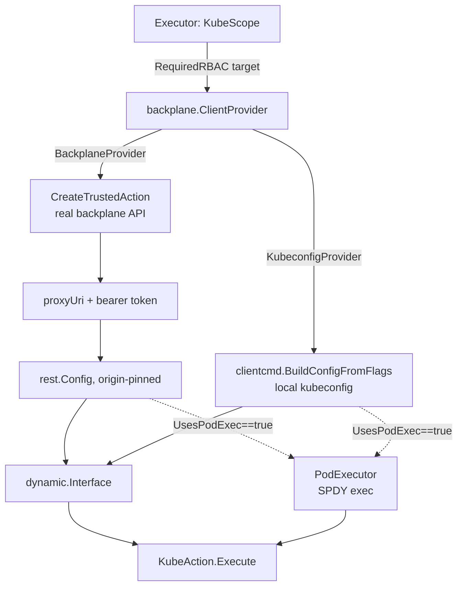

## Overview

`internal/backplane` is how the server reaches the Kubernetes API of a managed
cluster. It is the Kubernetes counterpart of `internal/awsapi` (see
[Integration: AWS Access & Actions](aws.md)): both talk to the same
[OpenShift Backplane](https://github.com/openshift/backplane-api) service for
different purposes. `internal/executor`'s `KubeScope` is the only caller of
this package in the execution path; it holds a `backplane.ClientProvider` and
uses it to provision the Kubernetes clients each `KubeAction` needs. See
[Execution Pipeline & Scopes](../concepts/execution-pipeline.md) for how
`KubeScope.Run` fits among the other scopes.



## The ClientProvider interface

```go
type ClientProvider interface {
    GetClient(ctx context.Context, clusterID, actionName string, rbacRules []RBACRule) (dynamic.Interface, error)
    GetPodExecutor(ctx context.Context, clusterID, actionName string, rbacRules []RBACRule) (PodExecutor, error)
}
```

Both methods take the same three inputs — a target cluster, the name of the
action requesting access (used as the trusted-action's name/audit label), and
the RBAC rules that access should be scoped to. `RBACRule` mirrors a
Kubernetes policy rule (`Namespace`, `APIGroups`, `Resources`,
`ResourceNames`, `Verbs`); an empty `Namespace` means a cluster-scoped rule.
`PodExecutor` is a narrow interface (`Exec(ctx, namespace, pod, container,
command) ([]byte, error)`) used only by actions that exec into a pod.

Two implementations satisfy `ClientProvider`, selected once at server startup
and used for the whole process:

- **`BackplaneProvider`** — production path. Registers an HMAC-signed trusted
  action against the real backplane API and returns a `rest.Config` scoped to
  the `proxyUri` the backplane hands back.
- **`KubeconfigProvider`** — local/dev path. Builds a `rest.Config` directly
  from a local kubeconfig file via `clientcmd.BuildConfigFromFlags`, ignoring
  the `rbacRules` argument entirely (the kubeconfig's own identity and RBAC
  apply, whatever that identity's permissions are).

`cmd/server/main.go` picks between them the same way it picks between AWS
providers: if `ROSA_TA_KUBECONFIG` (`cfg.Kubeconfig`) is set, it constructs a
`KubeconfigProvider`; otherwise it validates `ROSA_TA_BACKPLANE_URL` is HTTPS,
builds an OCM connection, and constructs a `BackplaneProvider` whose token
function pulls a fresh access token from that connection on every call. The
same choice — and the same `ClientProvider` interface — is used by
`cmd/action-cli`, which always builds a `KubeconfigProvider` from a
user-supplied kubeconfig flag, since the CLI is a local, synchronous tool with
no backplane credentials of its own.

The server also refuses to combine mock auth with a real backplane: when
`ROSA_TA_AUTH=disabled`, `cmd/server/main.go` requires `ROSA_TA_KUBECONFIG` to
be set, because an unauthenticated request under mock auth would otherwise
receive a hardcoded role and reach production cluster infrastructure through
`BackplaneProvider`. This is the same hazard AWS's `ROSA_TA_AWS_ENDPOINT_URL`
requirement guards against on the AWS side — see
[Integration: AWS Access & Actions](aws.md).

## Least-privilege session model

`KubeScope.Run` does not open one broad session per cluster and reuse it.
Instead, for each primitive action execution, it asks the action for
`RequiredRBAC(target)` and calls `GetClient` with exactly those rules:

```go
rbacRules := action.RequiredRBAC(target)
client, err := s.backplane.GetClient(ctx, req.ClusterID, req.Action.Name(), rbacRules)
```

`GetPodExecutor` is only called — and a `PodExecutor` only provisioned and
attached to `actions.KubeClients` — when `action.UsesPodExec()` returns
`true`, using the same `rbacRules`. Actions that never exec into a pod (the
majority) never request or receive a pod executor. This means:

- A read-only action (e.g. `get`) requests only `get`/`list` rules on the
  single resource type and name it targets.
- An action that execs into a pod (e.g. `list-alerts`) additionally declares
  `pods/exec` in its `RequiredRBAC` and returns `true` from `UsesPodExec`, so
  its session is scoped to cover both the Kubernetes object access and the
  exec subresource.
- Each action execution gets its own session scoped to just what that one
  call needs; nothing is granted ahead of need, and nothing persists past the
  call. A composite action that ran several sub-actions could in principle
  merge their RBAC rules and call `GetClient` once to share a session, but the
  current design does not do this — one call, one scoped session.

See [Trusted Actions Catalog](../concepts/trusted-actions-catalog.md) for how
individual actions declare `RequiredRBAC` and `UsesPodExec`.

## BackplaneProvider: session request and origin pinning

`BackplaneProvider.requestAccessAndConfig` is the shared path behind both
`GetClient` and `GetPodExecutor`:

1. **`requestAccess`** calls `CreateTrustedAction` on the backplane API
   (`bpclient`), submitting a `CreateTrustedActionRequest` built from the
   `[]RBACRule` by `buildCreateRequest`: rules with an empty `Namespace`
   become `ClusterRoleRules`; rules with a namespace are grouped by namespace
   into `Roles` (sorted for determinism). The request's `Authorization` header
   carries a bearer token from `tokenFunc` — this is the HMAC-signed,
   OCM-derived token proving the request is a legitimate trusted action.
   `CustomerDataAccess` is always `false`.
2. The backplane response includes a `ProxyUri` the caller must use for
   subsequent Kubernetes requests. **Origin pinning**: `requestAccessAndConfig`
   resolves `ProxyUri` against the configured base backplane URL
   (`base.ResolveReference(ref)`) and requires the resolved scheme and host to
   exactly match the base URL's scheme and host. If backplane ever returned a
   proxy URI pointing at a different origin — whether from a compromised or
   misbehaving backplane, a bug, or a malicious response — the provider
   refuses to build a client against it rather than silently sending the
   trusted action's token to an unverified host. This matters because the
   bearer token attached to every subsequent request is also used to
   authenticate the trusted-action session itself; leaking it to an
   unintended origin would be a credential leak, not just a failed request.
3. The resulting `rest.Config` points `Host` at the resolved, origin-verified
   proxy URL and wraps the transport (`bearerTransport`) so that the bearer
   token is attached to every request — but only when the outgoing request's
   host matches the pinned `trustedHost` (or has no host set), so a redirect
   or rewrite elsewhere in the transport chain can't carry the token off the
   verified origin either.

`GetClient` wraps the resulting `rest.Config` in a `dynamic.Interface`
(`dynamic.NewForConfig`). `GetPodExecutor` wraps it in a `kubernetes.Interface`
clientset and returns a `backplanePodExecutor`, whose `Exec` posts a
`pods/exec` subresource request and streams the result via
`remotecommand.NewSPDYExecutor`, capturing stdout/stderr into byte buffers.

## KubeconfigProvider

`KubeconfigProvider` is intentionally simple: both `GetClient` and
`GetPodExecutor` call `clientcmd.BuildConfigFromFlags("", kubeconfigPath)` and
build the same kind of `dynamic.Interface` / pod-exec clientset directly from
it, logging (at debug level) that the supplied `rbacRules` are ignored — the
kubeconfig's own identity and whatever RBAC that identity already has in the
cluster is what actually governs access. It is used by:

- `cmd/server`, when `ROSA_TA_KUBECONFIG` is set (local development, or the
  mock-auth safety-guarded local mode).
- `cmd/action-cli`, which always uses a kubeconfig since it runs locally and
  synchronously with no production backplane credentials.

Because it ignores `rbacRules`, it is not a least-privilege enforcement point
by itself — the least-privilege guarantee in these modes comes from scoping
the kubeconfig's own RBAC (e.g. a limited service account), not from anything
`KubeconfigProvider` checks.

## BackplaneProvider and awsapi.CloudCredentialsProvider share one service

`BackplaneProvider` and `awsapi.CloudCredentialsProvider` both talk to the
same backplane service but for different purposes, and both are wired up in
`cmd/server/main.go`:

- `BackplaneProvider` calls backplane's HMAC-signed trusted-action endpoint
  and comes back with a `proxyUri` for reaching the cluster's Kubernetes API.
- `CloudCredentialsProvider` runs `backplane-cli`'s cloud-credential flow and
  comes back with short-lived AWS STS credentials for the cluster's own AWS
  account.

They are named for what each one obtains (a kubeconfig-equivalent session vs.
AWS credentials), not for the backplane service both reach, specifically so
the shared name does not make a reader conflate them. See
[Integration: AWS Access & Actions](aws.md) for the AWS side.

## Local test doubles

Neither of the two implementations above is exercised in automated local
tests against a real backplane. Instead, two separate local servers stand in
for backplane, chosen by what the test needs:

| | `tests/mock-backplane` | `tests/proxy-backplane` |
|---|---|---|
| Engine | [Imposter](https://www.imposter.sh/) fixture mock | Purpose-built Go reverse proxy (`go run ./tests/proxy-backplane`) |
| Backing data | Canned fixture (`data/cluster.json`), in-memory, deterministic | A real kubeconfig supplied at registration; forwards to a live cluster |
| RBAC enforcement | Matches rules against the fixture's declared `identity` (apiGroup/resource/namespace), independent of what the fixture actually holds | None — the proxy injects the kubeconfig's own bearer token and lets the upstream cluster's real RBAC decide |
| Use when | You need fast, deterministic, offline tests of RBAC-scoping and provisioning logic without any cluster | You need to exercise real Kubernetes API behavior (discovery, real object shapes, real writes) that a static fixture cannot model |

Both expose the same `proxyUri`-based contract as the real backplane
(`POST /backplane/trustedactions/{cluster_id}` to register, `DELETE
.../{cluster_id}/{instanceId}` to tear down, and a reverse-proxied path under
the singular `/backplane/trustedaction/{cluster_id}/{instanceId}/*` for
Kubernetes requests), so a `BackplaneProvider` pointed at either one behaves
as it would against the real service, modulo what each double actually
checks.

### tests/mock-backplane

An Imposter-based mock, started with `make mock-backplane` (on port 8080 by
default, or a chosen `MOCK_BACKPLANE_PORT` to run alongside `make run`). State
lives entirely in memory and resets on restart, so nothing leaks between
test runs.

Key properties:

- **Not a real Kubernetes API.** It fails API discovery (`/api`, `/apis`,
  `/api/v1` are unmodelled), so `kubectl` cannot drive it. Tests must either
  use `curl` directly or construct a `dynamic.Interface` /
  `rest.Config{Host: proxyUri}` that names an explicit GroupVersionResource,
  which skips discovery.
- **Fixture-driven, with loud gaps.** `data/cluster.json` keys entries by
  `{clusterId}:{kubernetes path}`. A request for a path with no fixture entry
  answers `501`, distinct from a `403` for a path the trusted action never
  requested RBAC for, and distinct from a fixture entry explicitly set to
  `"object": null` (a modelled `404`). This separation exists so a gap in the
  mock's coverage can never be mistaken for a legitimate not-found or a
  passing negative test.
- **RBAC is matched the way Kubernetes matches it**: `*` in `verbs`,
  `apiGroups`, or `resources` matches anything; `resourceNames` narrows a
  grant to the named objects; a rule's declared `identity` in the fixture
  is only a description of what the resource is, never a ceiling on what a
  trusted action may be granted — only the rules the action actually
  requested govern access.
- **Cross-cluster isolation** falls out of the composite-key design
  (`{clusterId}:{path}` for fixtures, `{clusterId}:{instanceId}` for issued
  actions) rather than from explicit isolation logic: pasting one cluster's
  instance ID into another cluster's proxy path is refused because that
  composite key was never written.
- **Deliberate deviations from the real contract**, documented in its README,
  should not be mistaken for bugs: the mock's expiry window (24h) is longer
  than the real `CreateTrustedActionResult.expiry` contract (720 minutes) and
  is never enforced against the wall clock; its forbidden-rule validation
  policy is a hand-transcribed copy of backplane's (undocumented) behavior and
  can silently drift; and its vendored OpenAPI spec is not automatically
  checked against the upstream client's spec for drift.

### tests/proxy-backplane

A lightweight, purpose-built reverse proxy, started with `make
proxy-backplane` or `go run ./tests/proxy-backplane` (`:8080` by default,
overridable via `--listen-addr` or `PROXY_BACKPLANE_PORT`). Unlike the
Imposter mock, it is backed by a real cluster:

1. **Register**: `POST /backplane/trustedactions/{cluster_id}` with a
   base64-encoded kubeconfig in the body. The server parses TLS credentials
   from the kubeconfig and builds an `http.Transport`, storing the entry in
   memory.
2. **Proxy**: requests under the returned `proxyUri` have the proxy prefix
   stripped and are forwarded to the upstream cluster, with the kubeconfig's
   bearer token injected — so requests run with whatever RBAC permissions
   that kubeconfig's identity actually has. Any HTTP method is forwarded,
   so write operations (create/patch/delete) can be exercised end-to-end
   against a real cluster, not just reads.
3. **Delete**: removes the in-memory entry; the upstream cluster is not
   contacted.

Use this double specifically when a test needs real cluster behavior a static
fixture cannot provide — e.g. real API discovery, real object defaulting, or
verifying that a write action's Kubernetes call actually succeeds against a
live apiserver — at the cost of needing a real kubeconfig and cluster to
point it at.

See [Integration Tests & Mocks](../testing/integration-and-mocks.md) for how
these doubles fit into the broader test suite, and
[Local Development](../operations/local-development.md) for running the
server against either one.
