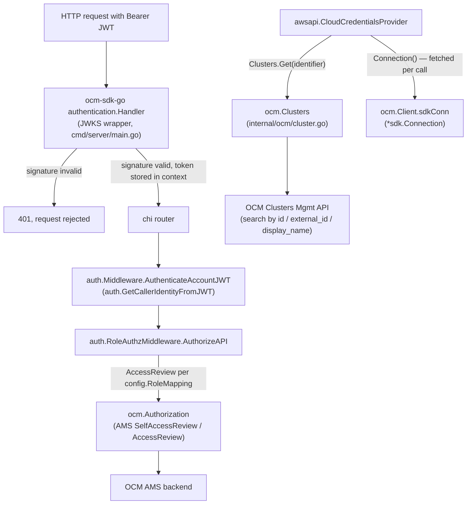

## Overview

`internal/ocm` is the server's client for OpenShift Cluster Manager (OCM). It is
used for three distinct things, all backed by one `ocm.Client` connection:

1. **JWT signature validation**, performed not by this package but by an
   `ocm-sdk-go` handler wrapped around the whole HTTP router in
   `cmd/server/main.go`, which places a verified token in the request context.
2. **AMS role resolution** — `ocm.Authorization.AccessReview` answers "is this
   username allowed to `get` this AMS resource type?", which
   `auth.RoleAuthzMiddleware` uses to resolve a caller's coarse role (see
   [Authorization Model](../concepts/authorization-model.md)).
3. **Cluster lookup** — `ocm.Clusters.Get` resolves a caller-supplied identifier
   (internal ID, external ID, or display name) to an OCM cluster object, used by
   the AWS cloud-credentials flow to find which account a target cluster lives
   in (see [Integration: AWS](aws.md)).


*Caption: a request's JWT is first validated by the JWKS wrapper, then
`internal/auth` extracts identity and resolves a role via AMS `AccessReview`;
separately, the AWS credential flow asks the same `ocm.Client` to resolve a
cluster and to hand over a freshly-fetched connection.*

## JWKS validation wrapper (`cmd/server/main.go`)

Signature validation happens **outside** `internal/ocm`, as an `http.Handler`
wrapped around the entire `chi` router (not just the `/api/v0/trusted-actions`
subtree). It is built only when `cfg.AuthPolicy != config.DisabledAuthPolicy`:

```go
builder := authentication.NewHandler().
    Logger(authnLogger).
    KeysURL(cfg.JWKCertURL).
    Public("^/health$").
    Next(mainHandler)

if cfg.JWKCertFile != "" {
    builder = builder.KeysFile(cfg.JWKCertFile)
}

mainHandler, err = builder.Build()
```

- **`authentication.NewHandler()`** comes from `ocm-sdk-go/authentication`, the
  same SDK used for the `ocm.Client` connection. It fetches the JWKS document
  from `KeysURL` (`cfg.JWKCertURL` / `ROSA_TA_JWK_CERT_URL`, default
  `https://sso.redhat.com/auth/realms/redhat-external/protocol/openid-connect/certs`)
  and validates every request's `Authorization: Bearer` JWT against it.
- **`KeysFile(cfg.JWKCertFile)`** (`ROSA_TA_JWK_CERT_FILE`) is added only when
  set, letting a deployment pin JWKS keys to a local file instead of (or in
  addition to) fetching them over the network — useful for air-gapped or
  test environments.
- **`Public("^/health$")`** exempts the health check from JWT validation, so
  liveness/readiness probes do not need a token. Every other route, including
  ones nominally mounted outside `/api/v0/trusted-actions`, passes through this
  handler before reaching the router.
- On success, the handler stores the verified `*jwt.Token` in the request
  context using the SDK's own context key. It does **not** extract identity
  itself — that is `auth.GetCallerIdentityFromJWT`'s job, called later by
  `auth.Middleware.AuthenticateAccountJWT` inside the chi middleware chain (see
  [Authorization Model](../concepts/authorization-model.md)).
- This wrapper is only built when auth is enabled (`enabled` or `ocmconfig`
  policy). Under `ROSA_TA_AUTH=disabled`, `mainHandler` stays the bare router,
  avoiding a network call to a JWKS endpoint and a `logger.Fatal` at startup in
  local/dev/CI environments where no real OCM endpoint is reachable.

### From verified token to `CallerIdentity`

`auth.GetCallerIdentityFromJWT` (`internal/auth/context.go`) is the bridge
between the JWKS wrapper's verified token and the rest of the server:

- It calls `authentication.TokenFromContext(r.Context())` to retrieve the
  `*jwt.Token` the JWKS wrapper stored; a missing or nil token is an error,
  which `auth.Middleware.AuthenticateAccountJWT` turns into `401 Unauthorized`.
- It type-asserts `token.Claims` to `jwt.MapClaims` and reads `username`,
  `email`, and `clientId` (RHSSO claim keys), falling back to
  `preferred_username` (RHD claim key) when `username` is empty.
- The result is a `CallerIdentity{Username, Email, ClientID}`, stored in the
  request context via `SetCallerIdentityContext` for every downstream layer —
  AMS role resolution, audit logging, and action execution — to read via
  `GetCallerIdentityFromContext`.
- A token that parses but carries no recognizable username claim surfaces as
  an empty `Username`, which `auth.Middleware` also rejects with `401`.

## `internal/ocm.Client`: connection setup

`ocm.NewClient(config Config)` builds one long-lived `ocm.Client` per server
process, used for both AMS checks and cluster lookups (and handed, via
`Connection()`, to the AWS credentials flow). `cmd/server/main.go` builds the
`Config` differently depending on `cfg.AuthPolicy`:

- **`enabled`** — static configuration straight from the server's own config:
  `ocm.Config{BaseURL: cfg.OCMBaseURL, ClientID: cfg.OCMClientID, ClientSecret:
  cfg.OCMClientSecret, Tokens: [cfg.OCMToken if set]}`. This is the production
  path: credentials come from `ROSA_TA_OCM_BASE_URL` / `ROSA_TA_OCM_CLIENT_ID` /
  `ROSA_TA_OCM_CLIENT_SECRET` / `ROSA_TA_OCM_TOKEN` (or their config-file
  equivalents — see [Configuration](../operations/configuration.md)).
- **`ocmconfig`** — reads the local `ocm-cli` config file via
  `ocmconfig.Load()` (`github.com/openshift-online/ocm-cli/pkg/config`) and
  builds the same `ocm.Config` from `ocmConfig.URL` /
  `ocmConfig.ClientID` / `ocmConfig.ClientSecret`, with `Tokens` populated from
  `ocmConfig.AccessToken` and `ocmConfig.RefreshToken` (in that order). This
  policy lets a developer authenticate the server with whatever `ocm login`
  session is already on disk, without duplicating OCM credentials into the
  server's own config.
- Both policies require the same non-empty `[]config.RoleMapping` list
  (`roles:` in the config file) — the server calls `logger.Fatal` at startup if
  it is empty, or if any entry has an empty `id` or `amsResource`.
- Either way, failure to build the client (`ocmconfig.Load()` error, or
  `ocm.NewClient` error) is fatal at startup — there is no degraded mode that
  starts the server without a working OCM connection once auth is enabled.
- The resulting client is closed on server shutdown (`ocmClient.Close()`).

Inside `NewClient`, `client.newConnection()` picks between
`client.buildConn` (set only by tests) and `client.buildDefaultConnection()`,
which calls `sdkClient.NewConnectionBuilder()` with the configured `URL`,
optional `Client(ClientID, ClientSecret)`, and `Tokens(...)` if any were
supplied. **At least one of a client secret or a token is required** —
`buildDefaultConnection` returns an error ("no client secret or token has been
provided") otherwise, since the SDK connection cannot authenticate with
neither.

### The `ocmConnection` interface and test fakes

`Client.connection` is typed as the narrow `ocmConnection` interface
(`Tokens(expiresIn ...time.Duration) (string, string, error)`, `Close() error`)
rather than the concrete `*sdkClient.Connection`, specifically so unit tests
can substitute a `mockConnection` (`internal/ocm/client_test.go`) via
`Client.buildConn` instead of talking to a real OCM backend. Production code
always sets `client.connection` to an actual `*sdkClient.Connection`.

`Client.sdkConn()` recovers the concrete connection by type-asserting
`c.connection.(*sdkClient.Connection)`, returning an error rather than
panicking if the assertion fails — which happens only in tests that use a fake
connection and then exercise code paths requiring the real SDK type (e.g.
`authorization.AccessReview` and `clusters.Get`, both of which call `sdkConn()`
first and cannot run against a bare `ocmConnection` fake).

### Token extraction for `connUsername`

After building a connection, `newConnection()` calls `conn.Tokens()` to obtain
the current access token and passes it to `getUsernameFromJWT`, which parses
the token **unverified** (`jwt.Parser.ParseUnverified`, no signature check — the
token just came from the connection the client itself built, so re-verifying it
buys nothing) and reads its `username` claim. The result, `connUsername`, is
stored on the `Client` and compared against the caller's identity in
`Authorization.AccessReview` to decide between a self access review and an
access review against another account (see below). Any failure to fetch or
parse a token falls back to `"anonymous"` rather than failing the whole
connection setup.

## Authorization: AMS `AccessReview`

`ocm.Authorization.AccessReview(ctx, username, action, resourceType)`
(`internal/ocm/authorization.go`) is the sole primitive `auth.RoleAuthzMiddleware`
uses to resolve a caller's role (see
[Authorization Model](../concepts/authorization-model.md) for the full
request-time flow). Its implementation branches on whether the caller being
checked is the client's own connection identity:

- If `username == a.client.connUsername`, it issues OCM's
  **`SelfAccessReview`** (`con.Authorizations().V1().SelfAccessReview()`),
  built from `action` and `resourceType` only — no username parameter, because
  the review is implicitly about the caller the connection authenticates as.
- Otherwise, it issues a regular **`AccessReview`**
  (`con.Authorizations().V1().AccessReview()`), additionally supplying
  `AccountUsername(username)` so AMS evaluates permissions for a specific
  *other* account than the one the connection is authenticated as — the usual
  case in production, where the connection authenticates as a service account
  distinct from every end user making requests.
- Both paths call `con.Authorizations().V1()...Post().Request(request).SendContext(ctx)`
  and read `response.Allowed()` from the result; an empty response (no
  `GetResponse()` payload) or a transport error is surfaced as a Go `error`,
  which `auth.RoleAuthzMiddleware` treats as a failed check for that one
  `config.RoleMapping` entry (continuing to the next, and returning `500` only
  if *every* entry errors).
- `Authorization` is exposed as the `ocm.Authorization` interface specifically
  so `auth.RoleAuthzMiddleware` and its tests can be driven by
  `ConfigurableMockAuthorization` (`internal/ocm/authorization_mock.go`, a
  per-username allowlist of resource types) instead of a live AMS connection.

Each configured `config.RoleMapping{ID, AMSResource}` (the `roles:` list —
see [Configuration](../operations/configuration.md)) is checked, in order, with
`action` hardcoded to `"get"` by `auth.RoleAuthzMiddleware`; the first
`AMSResource` that AMS grants `"get"` access to becomes the caller's resolved
role `ID` for the rest of the request.

## Clusters: identifier resolution

`ocm.Clusters.Get(ctx, identifier)` (`internal/ocm/cluster.go`) resolves a
single caller-supplied string to an OCM `*cmv1.Cluster`, matching what an SRE
would plausibly paste into a tool: the cluster's **internal ID**, its
**external ID** (an RFC4122 UUID), or its **display name**.

### Input validation regex

Before touching the network, `Get` validates the identifier against:

```go
var clusterIdentifierRe = regexp.MustCompile(`^[a-zA-Z0-9-]{1,64}$`)
```

This is a security boundary, not a convenience check: the identifier is
interpolated directly into an OCM search-query string (see below), so the
regex exists to guarantee the value can only ever appear in that string as an
innocuous literal — no quotes, spaces, slashes, or newlines that could break
out of the intended `'...'` literal or otherwise alter the query. It validates
the **character class** shared by all three accepted identifier forms (hex
digits, letters, digits, and dashes), not the shape of any one format
specifically, and caps length at 64. `Get` rejects an invalid identifier with
an error *before* calling `c.client.sdkConn()`, so a malformed identifier never
reaches a real connection — verified directly by
`TestClusters_GetRejectsBeforeQuerying`, which exercises a `Client{}` with no
connection at all and relies on the validation failing first.

### Lookup and ambiguity handling

A validated identifier is embedded in an OCM search expression that matches
any of the three fields by exact equality (not substring/wildcard matching):

```go
search := fmt.Sprintf("(id = '%[1]s' or external_id = '%[1]s' or display_name = '%[1]s')", identifier)
```

`Get` requests this search against `ClustersMgmt().V1().Clusters().List()`
with `Size(2)` — just enough to detect an ambiguous match without fetching a
full result page — and then:

- A non-`200` response status, or a transport error, is returned as an error
  naming the identifier.
- `response.Total() > 1` is itself an error ("cluster identifier %q is
  ambiguous: it matches %d clusters") — `Get` never guesses among multiple
  matches, which matters because a display name is not guaranteed unique
  across accounts the way an internal or external ID is.
- `response.Total() == 0` is an error ("no cluster found for %q").
- Otherwise, the single matching `cmv1.Cluster` is returned.

`Clusters` is exposed as an interface specifically so the AWS
cloud-credentials provider and its tests can be driven without a live OCM
connection (see [Integration: AWS](aws.md)).

## `Connection()`: a fresh accessor, not a captured token

```go
func (c *Client) Connection() (*sdkClient.Connection, error) { return c.sdkConn() }
```

`cmd/server/main.go` passes `ocmClient.Connection` itself — the method value,
not its result — to `awsapi.NewCloudCredentialsProvider` as the accessor
`backplane-cli`'s cloud-credential flow uses to obtain a token:

```go
awsProvider = awsapi.NewCloudCredentialsProvider(logger, awsapi.CloudCredentialsConfig{...},
    ocmClient.Clusters, ocmClient.Connection)
```

This matters because `backplane-cli` needs a live `*sdkClient.Connection`
(rather than a bare string token) in order to refresh the token itself over
the life of a potentially long-running credential exchange. Handing over the
accessor — rather than calling `Connection()` once at startup and passing the
resulting value — means every credential fetch re-reads `c.connection`
through `sdkConn()`, so a token refreshed by the SDK's own background renewal
is always what the AWS flow actually uses; nothing is captured once at boot
and allowed to go stale. The server does call `ocmClient.Connection()` once at
startup, but only to confirm it does not error (failing fast if, for example,
`c.connection` were ever a fake) — the returned connection value is discarded,
confirmed by the doc comment on that call site.

`Connection()` can fail in one situation: when `c.connection` is not a
concrete `*sdkClient.Connection` (i.e. a test fake substituted via
`buildConn`). Production code always has a real SDK connection, so this error
path exists for test safety, not for any expected production failure mode.

## Configuration reference

| Setting | Config key | Purpose |
|---|---|---|
| `OCMBaseURL` | `ROSA_TA_OCM_BASE_URL` | OCM API base URL for the static (`enabled`) connection; default `https://api.openshift.com`. |
| `OCMClientID` / `OCMClientSecret` | `ROSA_TA_OCM_CLIENT_ID` / `ROSA_TA_OCM_CLIENT_SECRET` | Service-account credentials for the static connection. |
| `OCMToken` | `ROSA_TA_OCM_TOKEN` | Alternative to a client secret: a pre-obtained OCM token. |
| `JWKCertURL` | `ROSA_TA_JWK_CERT_URL` | JWKS endpoint the authentication wrapper fetches signing keys from. |
| `JWKCertFile` | `ROSA_TA_JWK_CERT_FILE` | Optional local JWKS file, used in addition to/instead of fetching over the network. |
| `Roles` (`[]config.RoleMapping{ID, AMSResource}`) | `roles:` in the config file | The ordered list `auth.RoleAuthzMiddleware` checks via `AccessReview`; required non-empty whenever auth is enabled. |
| `AuthPolicy` | `ROSA_TA_AUTH` (`enabled` / `ocmconfig` / `disabled`) | Chooses between the static OCM config, the local `ocm-cli` config file, or mock auth with no OCM connection at all. |

See [Configuration](../operations/configuration.md) for the full settings
reference and [Authorization Model](../concepts/authorization-model.md) for
how AMS role resolution fits into the broader request-authorization pipeline.
