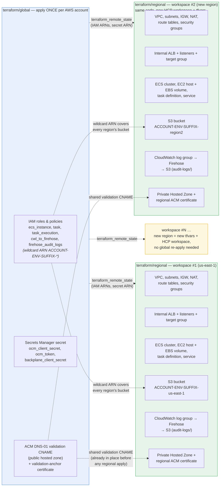
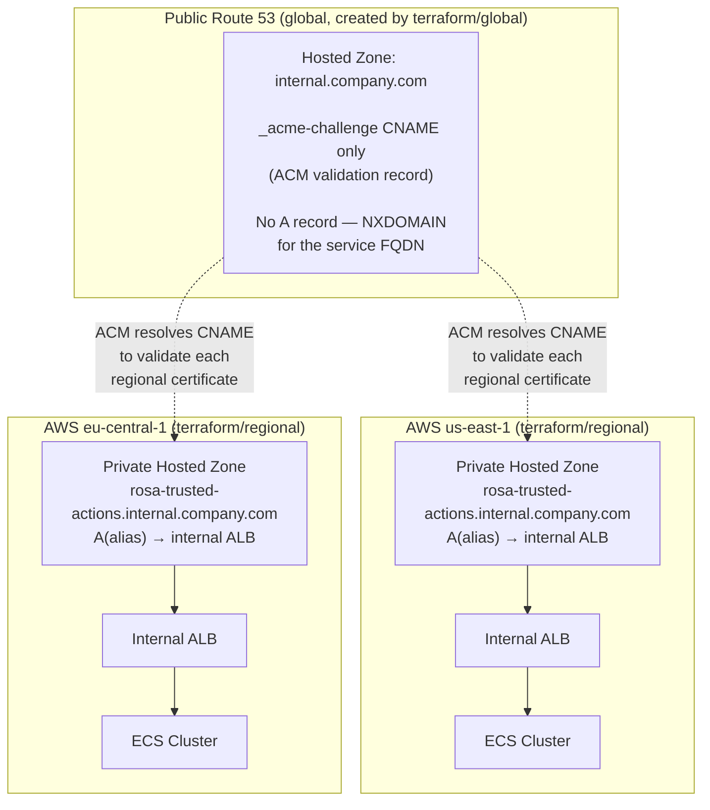

## Overview

The service deploys to AWS as a container running on ECS (EC2 launch type,
Phase 1) behind an internal Application Load Balancer, with one complete,
self-contained deployment per AWS region. Three mechanisms work together:

- **Terraform**, split into two roots (`terraform/global` and
  `terraform/regional`) that must be applied in a strict order.
- **HCP Terraform workspaces**, defined in
  `hcp-terraform/rosa-trusted-actions/main.tf`, which wrap those two roots in
  managed, remotely-executed workspaces with run triggers and state sharing.
- **Tekton pipelines** (`.tekton/`) and a **Containerfile**, which build and
  publish the container image that the regional Terraform root deploys.

This page documents all three, plus the private DNS/TLS model that lets every
regional deployment share one FQDN without exposing anything publicly.

---

## Two-root Terraform split

| Root | Path | Scope | Apply cadence |
|---|---|---|---|
| **global** | `terraform/global/` | Account-wide: IAM roles/policies, Secrets Manager secret, ACM DNS-01 validation CNAME | Once per AWS account |
| **regional** | `terraform/regional/` | One deployment per AWS region: VPC, ALB, ECS (EC2 host + EBS volume, task definition, service), S3 bucket, CloudWatch → Firehose audit-log pipeline, Route 53 Private Hosted Zone, regional ACM certificate | Once per region |

The regional root never receives IAM ARNs or the Secrets Manager ARN as
plain variables. Instead it reads them straight out of the global
workspace's Terraform state through a `terraform_remote_state` data source
(`terraform/regional/remote_state.tf`), aliased to `local.global` for
readability:

```hcl
data "terraform_remote_state" "global" {
  backend = "remote"
  config = {
    organization = "hp-platform-engineering"
    workspaces = { name = "rosa-trusted-actions-global" }
  }
}
locals {
  global = data.terraform_remote_state.global.outputs
}
```

This requires the global workspace to have state (i.e. to have been applied
at least once) and to have remote-state sharing enabled for the regional
workspace. The global root exports `secretsmanager_secret_arn`,
`iam_role_task_arn`, `iam_role_task_execution_arn`,
`iam_instance_profile_name`, `iam_role_cwl_to_firehose_arn`,
`iam_role_firehose_audit_logs_arn`, and `internal_fqdn`
(`terraform/global/outputs.tf`). The regional S3 bucket is created directly
in the regional workspace, not in global — `s3_bucket_name_suffix` must be
identical in both roots so the global workspace's IAM wildcard ARN
(`ACCOUNT-ENVIRONMENT-SUFFIX-*`) matches the bucket the regional workspace
creates.

Because global exposes IAM with wildcard resource ARNs rather than
per-region ARNs, it never needs to be re-applied when a new region is added.

### Resource ownership and multi-region fan-out



- **Blue (global)** — created once, shared by every region: IAM
  roles/policies, the app secret, and the ACM DNS-01 validation CNAME (plus a
  minimal "validation-anchor" certificate used only to obtain that CNAME
  token).
- **Green (regional)** — created per region: networking, ALB, ECS compute,
  that region's own S3 bucket, the Firehose audit-log pipeline, and DNS/TLS.
- **Yellow** — adding region N+1 touches only `terraform/regional`: a new
  tfvars file and a new HCP Terraform workspace. `global` is never
  re-applied for this; its IAM wildcard ARN already covers the new region's
  bucket by construction, and its validation CNAME already covers the new
  region's certificate because all regional certificates share the same
  `internal_fqdn`.

---

## HCP Terraform workspaces

Both Terraform roots are run as managed HCP Terraform workspaces, defined
declaratively via the `tfe` provider and a shared `workspaces` module in
`hcp-terraform/rosa-trusted-actions/main.tf`. **Apply this configuration
first** to create/update the workspaces themselves, then trigger runs from
the HCP Terraform UI or CLI.

| Workspace | Working directory | Must apply before |
|---|---|---|
| `rosa-trusted-actions-global` | `terraform/global` | all regional workspaces |
| `rosa-trusted-actions-stage` | `terraform/regional` | — |

### Apply order and dependency wiring

```
1. rosa-trusted-actions-global   (creates IAM, Secrets, S3-bucket IAM wildcard, ACM validation CNAME)
         │
         └─ source_workspaces trigger fires automatically on successful apply
                  ↓
2. rosa-trusted-actions-stage    (reads global outputs via terraform_remote_state)
```

The regional workspace definition sets `source_workspaces =
["rosa-trusted-actions-global"]`, which the `workspaces` TFE module turns
into a run trigger so a regional run queues automatically after global
applies successfully. The global workspace also declares
`remote_state_consumer_workspaces = ["rosa-trusted-actions-stage"]`, which
grants the regional workspace read access to global's state — this is what
makes `terraform/regional/remote_state.tf`'s `terraform_remote_state` data
source resolvable. No manual "copy this ARN into that workspace" step is
needed.

Both workspaces set `auto_apply = true` **and** `auto_apply_run_trigger =
true`: a plan is applied automatically whether it was queued directly
(e.g. by a VCS-triggered run) or by the run trigger fired from the other
workspace. There is no manual "confirm apply" gate in this configuration —
operators who need a hold point must pause the run or temporarily flip
`auto_apply` before applying. Both workspaces also attach to the
`rosa-trusted-actions-rosa-boundary-stage-rosa-trusted-actions-aws-dynamic-creds`
variable set for AWS credentials.

### Workspace variables

Variables are declared per workspace in `main.tf` as `terraform` category
(plan/apply) or sensitive (`backplane_client_secret`, `ocm_client_id`,
`ocm_client_secret`). Keys that **must match** across the global and
regional workspace for a given deployment: `s3_bucket_name_suffix` and
`internal_fqdn`. The regional workspace additionally carries
networking identifiers (`vpc_id`, `public_subnet_ids`,
`private_subnet_ids`), the `container_image` digest to deploy, and
Backplane/OCM application configuration. IAM ARNs and the Secrets Manager
ARN are deliberately **not** regional workspace variables — they only ever
come from `terraform_remote_state`.

The current `rosa-trusted-actions-global` workspace definition does **not**
set `public_zone_id` — that variable block is present only as a commented
template ("add when the public apex zone is available"). Since
`terraform/global/dns.tf`'s validation CNAME and validation-anchor
certificate, and `terraform/regional/acm.tf`'s regional certificate and
HTTPS listener, are all gated on `internal_fqdn != "" && public_zone_id !=
""`, this means the ACM/TLS path described below is currently inert for
this deployment and the ALB serves HTTP only, until an operator adds a real
`public_zone_id` value to the global workspace.

### Adding a new region

1. The global workspace does not need to change or be re-applied — its IAM
   policies already use wildcard ARNs and its validation CNAME already
   covers any region's certificate for the same `internal_fqdn`.
2. Add a new workspace block to the `workspaces` map in
   `hcp-terraform/rosa-trusted-actions/main.tf`, modeled on
   `rosa-trusted-actions-stage`, with `working_directory =
   "terraform/regional"`, `source_workspaces = ["rosa-trusted-actions-global"]`,
   and region-specific variables (`aws_region`, `vpc_id`,
   `public_subnet_ids`, `private_subnet_ids`, …).
3. Apply the `hcp-terraform/rosa-trusted-actions` configuration to create the
   new workspace, then trigger (or let the run trigger fire) its first plan.
   `terraform_remote_state` resolves the existing global outputs
   automatically.

### Local testing without HCP Terraform

Each root can also be applied directly with the Terraform CLI using a local
state backend. `terraform/regional/remote_state.tf` points at the HCP
Terraform remote backend by default; a gitignored `local_override.tf` in
`terraform/regional/` (an `_override.tf` file, which Terraform merges on top
of other files in the directory and which fully replaces a `data` block with
the same type/name) swaps in a `backend = "local"` pointing at
`../global/terraform.tfstate`, so a locally-applied global root can be read
by a locally-applied regional root without touching any committed file. See
`docs/deployment.md` for the exact commands. Teardown order matters: destroy
`terraform/regional` before `terraform/global`, because global owns the IAM
roles the regional ECS tasks depend on at runtime.

---

## Container build and CI/CD pipelines

### Containerfile

The image is a two-stage build (`Containerfile`):

1. **Builder stage** — `registry.access.redhat.com/hi/go:latest`, runs `go
   mod download` then `go build -o bin/rosa-trusted-actions-server
   ./cmd/server`.
2. **Runtime stage** —
   `registry.access.redhat.com/hi/core-runtime:latest@sha256:81280d7fd6afa7a3d2a6da2e90e545cf8e5d187c80a69b2a1c875fdcd731aaed`
   (pinned by digest, not just the `latest` tag, so the runtime base image
   cannot silently change between builds), copies only the built binary,
   exposes port `8080`, runs as non-root user `1001`, and sets
   `ENTRYPOINT ["rosa-trusted-actions-server"]`.

Port `8080` and the `/health` path are the same values `terraform/regional`
wires into the ECS target group's health check (see
`terraform/regional/alb.tf`), so a change to either must be made in both
places.

### Tekton pipelines

`.tekton/` holds two Konflux/Pipelines-as-Code `PipelineRun` definitions that
build the container image from the `Containerfile` using `buildah` with
trusted artifacts:

- **`rosa-trusted-actions-pull-request.yaml`** — triggered by
  `event == "pull_request" && target_branch == "main"`; validates PRs by
  building and scanning the image without necessarily publishing a tag other
  components depend on.
- **`rosa-trusted-actions-push.yaml`** — triggered by `event == "push" &&
  target_branch == "main"`; builds and pushes
  `quay.io/redhat-user-workloads/rosa-tenant/rosa-trusted-actions:{{revision}}`
  with `dockerfile: Containerfile` and `path-context: .`.

Both pipelines share the same task sequence: `init` → `clone-repository` →
`prefetch-dependencies` → `build-images` (matrix task, one `buildah`
invocation per entry in `build-platforms`, `linux/x86_64` by default) →
`build-image-index` (assembles the per-platform images into one OCI image
index) → `build-source-image` → `deprecated-base-image-check` → a battery of
image checks that all run against the freshly built index
(`roxctl-scan`, `ecosystem-cert-preflight-checks`, `sast-snyk-check`,
`clamav-scan`, `sast-shell-check`, `sast-unicode-check`,
`rpms-signature-scan`) → `apply-tags` → `push-dockerfile`. The resulting
`IMAGE_URL`/`IMAGE_DIGEST` results are what operators paste into a regional
HCP Terraform workspace's `container_image` variable (as a full
`...@sha256:<digest>` reference) to roll out a new build.

---

## Private networking, DNS, and TLS model

Each regional deployment is fully self-contained: its own VPC, its own
internal ALB, its own Route 53 Private Hosted Zone (PHZ). Every region uses
the **same FQDN** (e.g. `rosa-trusted-actions.internal.company.com`), but
that name resolves to a **different ALB** depending on which VPC the caller
is in — the same model Kubernetes uses for
`my-service.my-namespace.svc.cluster.local`, built from AWS primitives.
Traffic never crosses a region at the DNS layer.



Key properties, from `docs/networking.md`:

- The regional Private Hosted Zones have **identical names but different
  Zone IDs**; Route 53 identifies zones by ID, so there is no naming
  conflict. Each PHZ is associated with exactly one VPC
  (`terraform/regional/route53-private.tf`), and a VPC's built-in Route 53
  Resolver only ever answers from zones associated with that VPC — isolation
  is structural, not a routing policy that could be misconfigured.
- The **public** hosted zone never gets an A record for the service name —
  only the ACM DNS-01 validation CNAME. The FQDN is publicly unresolvable
  (NXDOMAIN from outside any of the VPCs).

### The shadow-zone pattern for TLS

ACM's DNS-01 challenge only requires that a CNAME be **resolvable** in a
publicly delegated zone — it never makes an HTTP request to the service
itself. This lets a certificate be issued for a name that has no public A
record at all, while the service endpoint stays entirely private:

1. `terraform/global/dns.tf` creates a minimal "validation-anchor" ACM
   certificate for `internal_fqdn` (never attached to any ALB) purely to
   obtain ACM's validation CNAME token, and writes that
   `_acme-challenge.<fqdn>` CNAME into the shared public Route 53 zone
   (`aws_route53_record.cert_validation`, keyed by `public_zone_id`).
2. Each regional workspace (`terraform/regional/acm.tf`) requests its own
   **regional** ACM certificate for the same `internal_fqdn` — ACM is a
   regional service, so an ALB in one region cannot reuse a certificate
   issued in another region — and then waits via
   `aws_acm_certificate_validation` for ACM to report the certificate
   `ISSUED`. Because all certificates share the same domain name, ACM
   derives the same validation CNAME for every one of them, so the single
   record global already wrote satisfies every region's certificate.
3. The resulting certificate is attached to that region's internal ALB
   HTTPS listener (`terraform/regional/alb.tf`), while the private A record
   for the service name lives only in that region's PHZ.

Because the validation CNAME is owned unconditionally by the global
workspace rather than by whichever regional workspace happens to apply
first, regional applies and destroys can run fully in parallel with no
race on a shared Route 53 record — this is why the global-before-regional
apply order in the previous section is a hard requirement: the CNAME (and
the IAM/secrets global creates) must exist before any regional workspace's
first apply. Certificates issued this way come from Amazon Trust Services
and are trusted by ordinary TLS clients with no custom CA distribution,
unlike a private-CA approach. ACM auto-renewal works the same way with no
manual steps: ACM re-validates against the already-present CNAME and
rotates the certificate.

An HTTPS listener and regional certificate are only created when both
`internal_fqdn` and `public_zone_id` are set; otherwise the ALB falls back
to HTTP-only (`local.https_enabled` in `terraform/regional/acm.tf`). An
operator can also bypass ACM entirely by supplying `alb_certificate_arn` for
a certificate managed outside Terraform.

---

## Related pages

- [Configuration](configuration.md) — application-level configuration
  (`ROSA_TA_*` environment variables) that the regional ECS task definition
  passes into the container.
- [Local Development](local-development.md) — running and testing the
  service outside this AWS deployment path.
