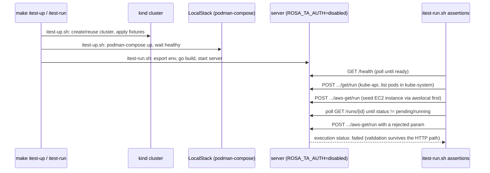

# Testing: Integration Harnesses & Mocks

This page documents the integration-test infrastructure that exercises
rosa-trusted-actions end to end, beyond the in-package unit tests
(`internal/actions/*_test.go` and friends). There are two independent harnesses:

- **`integration/`** — a phased, disposable **kind + LocalStack** environment that runs
  the real server binary against a real (if throwaway) Kubernetes cluster and a real
  (if community-tier) AWS emulator.
- **`tests/mock-backplane/` and `tests/proxy-backplane/`** — two interchangeable test
  doubles for the real Backplane API, driven by `tests/actions` (end-to-end action
  tests) independently of the kind/LocalStack harness.

A third, much thinner script, `scripts/test-api.sh`, is a smoke test for the HTTP API
surface itself rather than for any backing system.

## The kind + LocalStack harness (`integration/`)

Full integration testing would require two authentication backends (OCM and
Backplane) plus a real AWS account for audit logging — more than is practical for
local/CI iteration. Mock auth (`ROSA_TA_AUTH=disabled`, which swaps in
`MockMiddleware`/`MockAuthzMiddleware` — a hardcoded `dev-user` identity with the SREP
role and no OCM/AMS network calls) combined with `ROSA_TA_KUBECONFIG=<path>` (which
makes `cmd/server/main.go` select `KubeconfigProvider` instead of
`BackplaneProvider`) removes the Backplane and OCM dependency entirely, leaving only a
real cluster and a real-enough AWS endpoint to stand up. As a safety guard, the server
refuses to start with `ROSA_TA_AUTH=disabled` unless `ROSA_TA_KUBECONFIG` is also set —
mock auth against the real Backplane is not allowed — and the same guard requires
`ROSA_TA_AWS_ENDPOINT_URL` to be set, since mock auth hands every caller the SREP role
and the AWS SDK's default credential chain would otherwise reach for whatever ambient
credentials the host has.

The integration README documents this as a phased plan; only Phase 1 is built today.

### Phase 1 — local execution path (implemented)

**Goal:** prove a real execution request flows end to end — HTTP → auth middleware →
executor → a real (if disposable) cluster → response — with no OCM or Backplane
dependency.

- **`integration/itest-up.sh`** (`make itest-up`) creates a disposable `kind` cluster
  (image `kindest/node:v1.33.1`), reusing one with the same name
  (`ROSA_TA_KIND_CLUSTER_NAME`, default `rosa-ta`) if it already exists, then starts
  `podman-compose.yml` — `localstack/localstack`, the community AWS emulator — and
  waits for both to report healthy. It also applies fixtures
  (`integration/fixtures/pull-secret.yaml`, `prometheus.yaml`) and waits for Prometheus
  to fire at least two alerts, which later actions (`list-alerts`) depend on.
- **`integration/itest-run.sh`** (`make itest-run`) retrieves a fresh kubeconfig from
  the kind cluster, exports `ROSA_TA_AUTH=disabled`, `ROSA_TA_KUBECONFIG`,
  `DATABASE_URL`, and the AWS variables (`ROSA_TA_AWS_ENDPOINT_URL` pointed at
  LocalStack, placeholder static credentials, and `ROSA_TA_AWS_ALLOWED_REGIONS`, which
  has no built-in default), builds and starts the server binary, waits for `/health`,
  then drives one action per execution scope and polls `GET /runs/{id}` until each
  reaches a terminal status:
  - **kube-api** — `get` (list pods in `kube-system`, a namespace every stock kind
    cluster has), `describe-nodes` (all nodes, then a single named node), and
    `get-pull-secret-email` / `list-alerts` against the applied fixtures, asserting on
    response content (node conditions/capacity/pods, alert counts by severity), not
    just a `succeeded` status.
  - **aws-api** — `aws-get`. The script first seeds a tagged EC2 instance in
    LocalStack via `awslocal`, then asserts that instance appears in the action's
    output — a read that succeeds while returning nothing still counts as a failure.
    The same pattern (seed-if-needed, then assert on output) is repeated for every
    other `aws-get` resource LocalStack's community image can serve: `ec2-vpcs`,
    `ec2-subnets`, `ec2-route-tables`, `ec2-security-groups` (present by default),
    plus `ec2-dhcp-options` and `route53-hosted-zones`/`route53-record-sets`, which the
    script seeds explicitly since a fresh LocalStack has neither.
  - **rejected request** — finally the script submits an `aws-get` call with a param
    the resource does not accept and asserts the execution finishes `failed` rather
    than `succeeded` — input validation is only worth having if it survives the whole
    HTTP path, not just a unit test.

  The server is stopped on exit regardless of outcome. The script requires `kind`,
  `go`, `curl`, `jq`, and `podman` on `PATH`.
- **`integration/itest-down.sh`** (`make itest-down`) stops LocalStack, deletes the
  kind cluster, and removes generated local artifacts (`.kind-kubeconfig`,
  `.trusted_actions.db`, `.server.log`). Safe to run even if nothing is up.

**Known coverage gap — LocalStack Pro-only AWS reads.** Five `aws-get` resources
(`load-balancers`, `load-balancers-classic`, `target-groups`, `target-health`, and
`cloudtrail-events`) require the `elb`, `elbv2`, and `cloudtrail` services, which are
LocalStack **Pro** features. The community image `podman-compose.yml` uses answers
them with `InternalFailure: Sorry, the <service> service is not included in your
LocalStack license`, so `itest-run.sh` does not exercise them at all. They are covered
only by unit tests against fakes in `internal/actions` — a green `itest-run` run is
not evidence that this part of the AWS read surface works against a real API
implementation.

Other caveats called out in `integration/README.md` worth knowing about this harness:

- It does not exercise AWS **write** actions (`aws-reboot`, `aws-terminate`) — only
  reads. LocalStack does implement `RebootInstances`/`TerminateInstances`, but a write
  test would additionally need `ROSA_TA_AWS_ALLOWED_OPERATIONS` set and the seeded
  instance tagged with the static provider's infra ID; until that exists, the writes
  (including the ownership-tag check and both allowlist gates) are covered by unit
  tests only.
- It uses `awsapi.StaticProvider` (one fixed credential set, ignoring cluster ID) via
  `ROSA_TA_AWS_ENDPOINT_URL`, not the production `awsapi.CloudCredentialsProvider`
  path (which resolves the cluster in OCM and walks the Backplane/STS assume-role
  chain). The latter is unverified end to end in any harness today — see
  [AWS Integration](../integrations/aws.md).
- Audit logging has nothing to verify against yet: `cmd/server/main.go` still
  constructs `audit.NewMockLogger`, and there is no S3/CloudWatch client.

### Phases 2 and 3 — planned, not yet built

`integration/README.md` also sketches two further phases that are not implemented:

- **Phase 2 (OCM mocking)** would run with `ROSA_TA_AUTH=enabled`, pairing a local JWKS
  file (`ROSA_TA_JWK_CERT_FILE`) for JWT verification with a small fake HTTP server for
  AMS `AccessReview`, so the real `auth.Middleware` / `ocm.Authorization` code paths run
  against something other than mock auth.
- **Phase 3 (Backplane fake server)** would exercise the real
  `backplane.BackplaneProvider` HMAC request/response contract (currently flagged as
  untested against a real backplane instance in `internal/backplane/backplane.go`) by
  building a fake implementing `POST /backplane/trustedaction/{clusterID}` and the
  `/backplane/remediate/...` reverse-proxy path, pointed at via
  `ROSA_TA_BACKPLANE_URL`. This is a different target from the two Backplane doubles
  described below: those exist today and are driven by `tests/actions`, not by the
  `integration/` scripts, and neither implements the HMAC signing contract that
  `backplane.BackplaneProvider` itself uses.

## The two Backplane test doubles

Independently of the kind/LocalStack harness, `tests/mock-backplane` and
`tests/proxy-backplane` are both standalone HTTP servers that imitate the real
Backplane trusted-action API (`POST`/`GET`/`DELETE /backplane/trustedactions/...` for
CRUD, `/backplane/trustedaction/...` singular for the proxy) well enough for
`internal/backplane`'s `dynamic.Interface` client code and `tests/actions` to run
against. They are not alternative views of the same thing — they trade determinism for
realism in opposite directions, and `tests/actions/main_test.go` can run against
either (or both).

| | `tests/mock-backplane` | `tests/proxy-backplane` |
|---|---|---|
| Implementation | Imposter-based fixture server (YAML spec + JS scripts) | A real Go reverse proxy (`handler.go`, `store.go`) |
| Backing data | Static, in-memory fixture (`data/cluster.json`) | A live Kubernetes cluster, reached via a registered kubeconfig |
| Use when | Fast, deterministic, fixture-driven tests; verifying the CRUD/proxy contract shape and RBAC-matching logic | Exercising real Kubernetes API behavior — real object semantics, real server-side validation, real write side effects |
| Run with | `make mock-backplane` (requires the `imposter` CLI) | `make proxy-backplane` (requires a registered kubeconfig) |
| Driven by | `make test-actions` (`TEST_BACKPLANE=mock`) | `make test-actions-proxy` (`-run Proxy`, needs `KUBECONFIG`/`KUBECONFIG_B64`) |

### `tests/mock-backplane` — Imposter fixture server

This is an [Imposter](https://www.imposter.sh/)-based mock built from a vendored
OpenAPI-like spec (`tests/mock-backplane/backplane.yaml`) plus JS request scripts
(`scripts/`). `make mock-backplane` pins the Imposter Go engine (v5, native) and
disables config-directory auto-restart; state is held **in memory**, so restarting the
mock resets it and nothing leaks between runs. It listens on port 8080 by default
(same as `make run`; pass `MOCK_BACKPLANE_PORT` to use another).

Two properties define its contract:

- **Plural CRUD vs. singular proxy path asymmetry.** CRUD endpoints use the plural
  prefix, `/backplane/trustedactions/{clusterId}` (`POST` creates, `GET`/`DELETE`
  target `{clusterId}/{instanceId}`), while proxied Kubernetes requests use the
  singular `/backplane/trustedaction/{clusterId}/{instanceId}/*`. This matches the real
  Backplane contract — it is not a typo, and `tests/proxy-backplane` mirrors the same
  asymmetry.
- **In-memory CRUD and cluster state.** A trusted action's instance ID is minted per
  `POST`; `DELETE` and subsequent proxy calls key off `{clusterId}:{instanceId}`, and
  the cluster fixture keys off `{clusterId}:{kubernetes path}`. This composite-key
  design is what gives two preloaded clusters (`C1`/`C2` in the examples) automatic
  cross-cluster isolation: an instance ID minted against `C1` is simply absent from
  `C2`'s store, with no special-case code needed.

`kubectl` cannot be pointed at this mock directly — it performs API discovery
(`/api`, `/apis`, `/api/v1`) at startup, and discovery paths are not modelled. Tests
instead build a `dynamic.Interface` from `rest.Config{Host: proxyUri}`, which skips
discovery when a `GroupVersionResource` is supplied directly; this is exactly what
`tests/actions/main_test.go`'s `createMockSession` and `mockBackplaneProvider` do.

The cluster fixture (`data/cluster.json`) models what each `{clusterId}:{path}` holds
(`items` for a collection, `object` for a single resource, `"object": null` for a
genuine 404) and an `identity` block (API group/resource/namespace) that access is
judged against — but the identity block is descriptive, not a ceiling: only the RBAC
rules actually submitted on the trusted action grant access. The matcher reproduces
Kubernetes RBAC semantics (`*` wildcards, empty string for the core API group,
`resourceNames` narrowing a grant to specific objects, cluster-scoped/all-namespace
reads requiring `clusterRoleRules` rather than a namespaced `roles` entry) but is
deliberately incomplete in ways that fail loudly rather than silently:

- A path with no fixture entry at all answers `501`, distinct from a fixture entry
  explicitly marked absent (`404`) and from a request the submitted RBAC never granted
  (`403`) — three different gaps are kept visibly different rather than collapsed into
  one "not found."
- Selectors (`?labelSelector=`, `?fieldSelector=`) are accepted but ignored, with a
  logged warning, rather than silently returning a filtered-looking result.
- Subresources (e.g. `.../pods/pod-1/log`) and non-resource/discovery URLs are `501`.
- A permitted *write* is also `501` — the fixture only models reads, so it never
  pretends to have written something it did not persist.

Three further deliberate deviations from the real contract are documented so they are
not mistaken for bugs: the mock's token expiry is 24 hours rather than the real
contract's 720 minutes (unenforced either way, so harmless in practice); the
`FORBIDDEN_POLICIES` list in `scripts/trustedactions-post.js` is a hand-copy of
Backplane's unpublished 400-triggering validation rules, so it can silently drift; and
`backplane.yaml` is a manually-kept-in-sync vendored copy of the upstream client spec
with no automated divergence check.

### `tests/proxy-backplane` — real reverse proxy to a live cluster

Unlike the Imposter mock, this is a small Go HTTP server
(`handler.go`/`store.go`/`main.go`) that accepts a **real, base64-encoded kubeconfig**
at registration time and proxies every subsequent request straight through to the
cluster it describes:

1. **Register** — `POST /backplane/trustedactions/{clusterID}` with a `kubeconfig`
   field. The server parses TLS credentials from the kubeconfig, builds an
   `http.Transport`, and stores the entry (and its bearer token) in memory, returning a
   `proxyUri` and `instanceId`.
2. **Proxy** — any HTTP method against `/backplane/trustedaction/{clusterID}/{instanceId}/*`
   is stripped of its proxy prefix and forwarded upstream with the stored bearer token
   injected, so requests run with whatever RBAC the kubeconfig's identity actually has.
   Because it forwards any method, it is the harness of choice for exercising real
   writes (`POST`/`PATCH`/`PUT`/`DELETE` against pods, deployments, configmaps,
   namespaces, …), not just reads.
3. **Delete** — removes the in-memory entry; the upstream cluster is not contacted.

It shares the same plural-CRUD-vs-singular-proxy URL scheme as the Imposter mock (see
above) so client code — including `tests/actions`'s `proxyBackplaneProvider` — can
target either one behind the same interface. `make proxy-backplane` runs it on `:8080`
by default (`PROXY_BACKPLANE_PORT` to change it); `--listen-addr` and `--log-level`
are its only flags.

**When to use which:** reach for `tests/mock-backplane` for fast, deterministic tests
of the CRUD/proxy contract shape and RBAC-matching logic that don't need a real
cluster; reach for `tests/proxy-backplane` when a test needs genuine Kubernetes API
behavior — real object defaulting/validation, real write side effects, interaction
with admission control, or anything the fixture format in `data/cluster.json` cannot
express.

## `tests/actions` — end-to-end action tests

`tests/actions` (build tag `integration`) is a separate concept from the in-package
unit tests under `internal/actions/*_test.go`: where the unit tests exercise action
`Execute` logic against hand-built fakes, `tests/actions/main_test.go` and
`actions_test.go` run actions (and, for some tests, the full
`internal/executor.Executor`) against one of the two real Backplane doubles above,
reached over HTTP exactly as the production code would reach a real Backplane
instance.

`TestMain` probes both `MOCK_BACKPLANE_URL` (default `http://localhost:8087`) and
`PROXY_BACKPLANE_URL` (default `http://localhost:8088`) for reachability at startup,
and honors `TEST_BACKPLANE=mock` or `TEST_BACKPLANE=proxy` to require one specific
double; with neither variable set, it runs whatever is reachable and fails only if
neither is. Proxy-backed tests additionally require a kubeconfig via `KUBECONFIG_B64`
or `KUBECONFIG` and are run separately via `make test-actions-proxy` (`-run Proxy`),
since they need a real cluster rather than just the mock running. `make test-actions`
runs the mock-backed suite via `TEST_BACKPLANE=mock`.

Helper types reflect the asymmetric contract both doubles share: `createMockSession`
and `mockBackplaneProvider` POST to the plural `/backplane/trustedactions/{clusterID}`
endpoint and build a `dynamic.Interface` from the returned `proxyUri`, registering a
`t.Cleanup` that issues the matching `DELETE`; `createProxySession` and
`proxyBackplaneProvider` do the same against the real-cluster double, substituting a
base64 kubeconfig for RBAC rules in the request body.

## `scripts/test-api.sh` — thin API-level smoke test

`scripts/test-api.sh` (`make test-api`, or `make test-integration` which starts the
server first) is a much smaller, HTTP-only smoke test: it checks `/health`, lists
actions, describes one, and executes `get` with `dry_run: true` against whatever
server is already running at `SERVER_URL` (default `http://localhost:8080`). It does
not stand up a cluster, LocalStack, or either Backplane double — it only verifies the
API layer responds with the right status codes and JSON shape, and is the right tool
when the question is "is the HTTP surface itself working" rather than "does an action
produce the right result against a real backend."

## Related pages

- [AWS Integration](../integrations/aws.md) — the `StaticProvider` /
  `CloudCredentialsProvider` split that `itest-run.sh` exercises only the first half of.
- [Backplane Integration](../integrations/backplane.md) — the production
  `BackplaneProvider` HMAC contract that neither test double implements signing for.
- [Local Development](../operations/local-development.md) — running the server and
  these harnesses outside of CI.
- [Testing Strategy](./testing-strategy.md) — how this fits into the broader test
  pyramid alongside `internal/*/*_test.go` unit tests.
