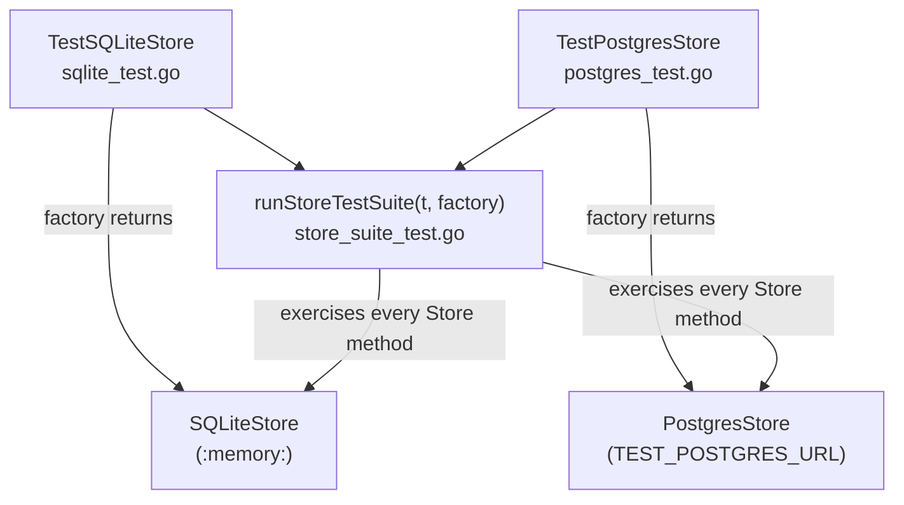

# Testing: Unit Test Conventions & Coverage

This page covers how unit tests are written and run in the ROSA Trusted Actions Server, how coverage is measured and enforced, and the shared behavioral test suite that keeps the two `Store` backends consistent. It intentionally excludes the kind/LocalStack/mock-and-proxy-backplane integration and end-to-end harnesses; see [Integration Tests & Mock/Proxy Backplanes](integration-and-mocks.md) for those.

## Running tests

The `Makefile` exposes the entry points used locally and in CI (`repo://Makefile#L124-L204`):

| Target | What it does |
|---|---|
| `make test` | Compiles the `integration`-tagged tests under `tests/actions/` (without running them, just to catch build breaks) and runs `go test -v ./...`. SQLite-backed store tests run by default; Postgres-backed store tests are skipped unless `TEST_POSTGRES_URL` is set. |
| `make test-race` | Runs the full suite with Go's race detector (`go test -race -v ./...`). |
| `make test-coverage` | Runs `go test -coverprofile=coverage.out ./...` and renders `coverage.html` via `go tool cover`. |
| `make test-integration` | Starts the server with `make run`, runs `scripts/test-api.sh` against it, and tears the server down. |
| `make test-api` | Runs `scripts/test-api.sh` against an already-running server (used standalone or as the second half of `test-integration`). |

Related, narrower targets exist for store-backend and action-level testing: `make test-postgres` spins up a disposable Postgres container and runs `./internal/store/...` against it, while `make test-actions` / `make test-actions-proxy` run the `tests/actions/` integration suite against the mock or proxy backplane (`repo://Makefile#L164-L214`). Those backplane harnesses, and the `kind`-based end-to-end flow (`make itest-up`/`itest-run`/`itest-down`), are documented in [Integration Tests & Mock/Proxy Backplanes](integration-and-mocks.md), not here.

CI runs lint, then `go test -race -coverprofile=coverage.out -covermode=atomic ./...`, uploads the profile to Codecov, and only builds the binary after lint and test succeed (`repo://TESTING.md#L132-L139`).

## Coverage requirements

Project documentation (`TESTING.md`, `CONTRIBUTING.md`, and the trusted-action workflow docs) states a patch coverage policy of **>= 80% on all PRs, enforced by Codecov** (`repo://TESTING.md#L94-L97`, `repo://CONTRIBUTING.md#L25`). `internal/handlers/` and `internal/config/` are called out as the primary targets: these packages contain the HTTP request-handling and configuration-parsing logic where regressions are most costly, so new code there is expected to be covered by table-driven unit tests.

The repository's `codecov.yml` configures Codecov's actual status checks: patch coverage target `50%` (threshold `1%`), project coverage target `35%`, round-down precision, and `require_ci_to_pass: no` (`repo://codecov.yml#L1-L21`). When changing coverage policy, treat `codecov.yml` as the source of truth for what Codecov will actually gate on a PR, and the >=80% figure in `TESTING.md`/`CONTRIBUTING.md` as the project's stated aspirational/documented policy — reconcile the two if you touch either file. Codecov ignores `**/mocks` and `**/zz_generated*.go` outright (`repo://codecov.yml#L36-L38`), and `TESTING.md` additionally excludes `vendor/`, `node_modules/`, `internal/openapi/` (generated), `**/*_test.go`, `tools.go`, and `docs/` from coverage accounting (`repo://TESTING.md#L110-L119`).

Generate a local HTML report with `make test-coverage`, then open `coverage.html`.

## Unit test conventions

`TESTING.md` defines the conventions unit tests must follow (`repo://TESTING.md#L53-L59`):

- **No test frameworks** — use the stdlib `testing` package and `net/http/httptest` for HTTP handler tests; no testify, gomega, etc. In practice this is the convention for most packages (e.g. `internal/executor`, `internal/actions`), though a few existing packages — `internal/handlers` and `internal/store` — mix plain stdlib checks with `github.com/onsi/gomega` matchers (`. "github.com/onsi/gomega"`, `g.Expect(...)`) in some subtests (`repo://internal/handlers/api_test.go#L13`, `repo://internal/handlers/api_test.go#L292`, `repo://internal/store/store_suite_test.go#L16`, `repo://internal/store/store_suite_test.go#L270-L297`). New tests should default to the documented stdlib-only style unless editing a file that already uses gomega.
- **Table-driven tests** — use `t.Run` subtests for testing multiple cases (`repo://TESTING.md#L61-L90`).
- **Test naming** — `Test<Type>_<Method>` or `Test<Type>_<Method>_<Scenario>`, e.g. `TestAPIHandler_CreateExecution_InvalidJSON`.
- **Test isolation** — each test builds its own handler/store instance and logger; no shared mutable state across tests. For example, `internal/handlers/api_test.go`'s `newTestHandler` constructs a fresh in-memory SQLite store and `APIHandler` per test, registering `t.Cleanup` to close it (`repo://internal/handlers/api_test.go#L40-L52`).
- **Assertions** — `t.Errorf` for non-fatal checks that let the rest of the test continue (e.g. checking several response fields), `t.Fatalf` for preconditions that would make further assertions meaningless (e.g. a failed setup call or an unparsable response body).

A minimal handler test constructs a logger and handler, drives it with `httptest.NewRequest`/`httptest.NewRecorder`, and asserts on the recorded response (`repo://TESTING.md#L37-L50`, `repo://internal/handlers/api_test.go#L54-L82`).

## Structural/invariant tests

Beyond behavioral unit tests, the codebase includes structural tests that assert an invariant across a registry or wiring graph, catching a whole class of omission bugs at compile/test time rather than at runtime.

`TestScopes_CoverEveryRegisteredAction` in `internal/executor/scope_test.go` is the canonical example: it builds an `Executor` wired with the real `KubeScope` and `AWSScope`, iterates every action name returned by `actions.GetActionsNames()`, and fails if `exec.scopeFor(action)` returns `nil` for any of them (`repo://internal/executor/scope_test.go#L19-L43`). The test's own comment states its purpose: `Execute` denies an action it has no scope for rather than running it unauthorized, so a missing scope mapping would otherwise only surface as a confusing authorization denial at runtime instead of a test failure at commit time. Any new action registered in `internal/actions` must be reachable from one of the scopes wired in `cmd/server`, or this test fails.

When adding a new action, follow the per-action test pattern already established under `internal/actions/*_test.go` (e.g. `aws_ec2_test.go`, `describe_nodes_test.go`, `list_alerts_test.go`): construct the action, exercise its name/RBAC/parameter-validation logic, and cover both success and error paths. See [Adding a Trusted Action](../workflows/adding-a-trusted-action.md) for the end-to-end checklist, which also calls out the >=80% patch coverage expectation for new action code.

## Shared store test suite

`internal/store` ships two `Store` implementations — `SQLiteStore` and `PostgresStore` — behind a single `Store` interface (see [Data Model & Persistence](../concepts/data-model-and-persistence.md)). Rather than duplicating test logic for each backend, `internal/store/store_suite_test.go` defines one shared behavioral contract and both `sqlite_test.go` and `postgres_test.go` run it against their respective implementation.

Key mechanics:

- `runStoreTestSuite(t *testing.T, factory func(*testing.T) Store)` registers one `t.Run` subtest per `Store` method/scenario (create, get, list with each filter, update status, update-with-result, claim-next, audit-entry creation/listing/foreign-key enforcement, etc.) and calls `factory(t)` once per subtest so each subtest gets a fresh, empty store (`repo://internal/store/store_suite_test.go#L40-L64`).
- `TestSQLiteStore` (`internal/store/sqlite_test.go`) supplies a factory that opens a new in-memory SQLite database (`NewSQLiteStore(ctx, ":memory:", ...)`) and registers `t.Cleanup` to close it, then calls `runStoreTestSuite` (`repo://internal/store/sqlite_test.go#L10-L29`). SQLite-specific migration mechanics (idempotent re-run, rollback, rollback-and-reapply) are tested separately in the same file.
- `TestPostgresStore` (`internal/store/postgres_test.go`) supplies a factory that opens a real `PostgresStore` against the URL in `TEST_POSTGRES_URL`, dropping and recreating the schema tables in `t.Cleanup`, and also calls `runStoreTestSuite`. The whole test is skipped via `t.Skip` when `TEST_POSTGRES_URL` is unset, so `go test ./...`/`make test` stay fast and Docker-free by default; `make test-postgres` sets the variable after starting a disposable Postgres container (`repo://internal/store/postgres_test.go#L11-L49`, `repo://Makefile#L172-L177`).

Because both backends run through the same `runStoreTestSuite`, the suite acts as the executable specification of the `Store` interface's behavioral contract: not-found semantics (`ErrNotFound`), filtering/pagination behavior of `ListExecutions`, audit-entry foreign-key enforcement, and status/output update semantics are guaranteed identical across SQLite and Postgres. A behavioral change to one backend that is not mirrored in the other — or a bug introduced in either — is caught by the same assertions rather than by backend-specific, potentially divergent tests. Most assertions in the suite use plain stdlib `t.Errorf`/`t.Fatalf` checks, though a few subtests (e.g. `testUpdateExecutionStatusAndOutput`) use `gomega`'s `Expect`/`To` matchers (`repo://internal/store/store_suite_test.go#L270-L297`).

## Related pages

- [Integration Tests & Mock/Proxy Backplanes](integration-and-mocks.md) — kind-based e2e, the mock/proxy backplane harnesses, and `tests/actions/` integration tests.
- [Data Model & Persistence](../concepts/data-model-and-persistence.md) — the `Store` interface and its SQLite/Postgres implementations.
- [Execution Pipeline](../concepts/execution-pipeline.md) — how `Executor` and scopes (covered by `TestScopes_CoverEveryRegisteredAction`) fit into request handling.
- [Adding a Trusted Action](../workflows/adding-a-trusted-action.md) — the per-action testing checklist and coverage expectations for new actions.
