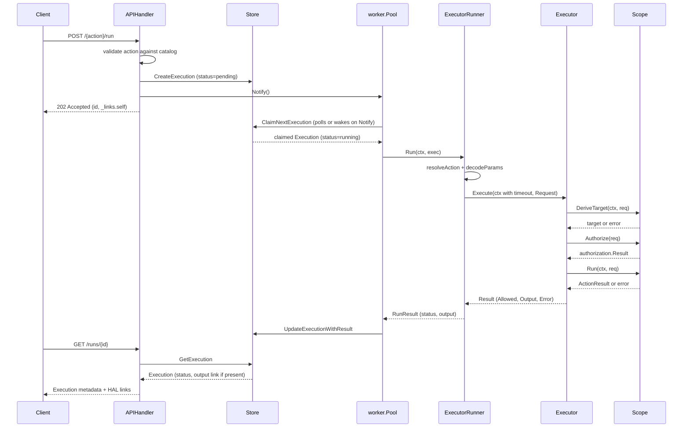

## Overview

Executing a trusted action is asynchronous end to end: the HTTP request that
submits the action and the background work that runs it are decoupled by a
persisted `Execution` row. `handlers.APIHandler.CreateExecution` only
validates the request and writes a `pending` row; `worker.Pool` is what
actually dequeues it and drives it through
[`internal/executor.Executor`](../concepts/execution-pipeline.md). The client
never blocks on the action itself — it submits, gets back `202 Accepted` with
an ID, and polls `GET /runs/{id}` until the execution reaches a terminal
status.

This page traces that full path — submission, dispatch, execution, and result
retrieval — and the three distinct ways a run can fail along the way. For the
authorization/target/scope mechanics inside `Executor.Execute` itself, see
[Execution Pipeline & Scopes](../concepts/execution-pipeline.md); for the
`executions` table shape, see
[Data Model & Persistence](../concepts/data-model-and-persistence.md); for the
OpenAPI spec this handler implements, see
[API Surface & Code Generation](../architecture/api-surface.md); for the
synchronous CLI path that runs the same `Executor` without a worker pool, see
[Workflow: CLI Clients](cli-clients.md).

## Sequence diagram

*Full lifecycle of one execution: submission, background dispatch, execution through a Scope, and client polling.*

## Step-by-step walkthrough

### 1. `POST /{action}/run` — validate and persist

[`APIHandler.CreateExecution`](../../internal/handlers/api.go) looks the
action up in `catalog.Catalog` first; an unknown action short-circuits with
`404 Not Found` before anything is persisted. A valid request body
(`openapi.ExecutionRequest`) is turned into a `models.Execution` via
`models.ExecutionFromRequest`, which assigns a new UUID, sets
`Status = "pending"` and `ApprovalState = "not_required"`, and stamps
`CreatedAt`/`UpdatedAt`. The row is written with `store.CreateExecution`
before the handler does anything else with it — the execution exists
durably, independent of whether a worker ever notices it.

### 2. Wake a worker

Immediately after the row is created, the handler calls
`h.notifier.Notify()`. `ExecutionNotifier` is a one-method interface
(`Notify()`) declared in `internal/handlers` purely to avoid an import
dependency on `internal/worker`; `worker.Pool` is the concrete implementation
passed in from `cmd/server/main.go`. `Notify` writes to a buffered,
capacity-1 channel without blocking (`select { case ch <- struct{}{}: default:
}`), so a burst of submissions coalesces into a single wakeup rather than
queuing one per request.

The handler then responds `202 Accepted` with the execution's current
(`pending`) representation and a `_links.self` HAL link pointing at
`GET /runs/{id}` — the client never waits for the action to run.

### 3. Dispatch — `worker.Pool` claims the row

Each of `cfg.WorkerConcurrency` worker goroutines loops: call
`store.ClaimNextExecution`, and if nothing is pending, block on
`select { case <-notify: case <-ticker.C: case <-ctx.Done(): }`. This means
correctness never depends on a `Notify` actually being delivered — a missed
notification, or a row inserted through any other path, is still picked up
on the next `pollInterval` tick (`ROSA_TA_WORKER_POLL_INTERVAL`, default
5s). `ClaimNextExecution` is atomic: `PostgresStore` uses
`SELECT ... FOR UPDATE SKIP LOCKED` inside a transaction to pick the oldest
`pending` row, flip it to `running`, and return it, so multiple concurrent
workers never race for the same execution and never block each other on
unrelated rows. `SQLiteStore` implements the equivalent single-writer-safe
claim for the embedded-database deployment mode.

### 4. Run — `ExecutorRunner` drives `executor.Executor`

`worker.Pool.process` hands the claimed `*models.Execution` to
`ExecutorRunner.Run`, the `Runner` implementation that bridges the stored row
to the domain-level `executor.Request`:

1. `resolveAction(exec.Action)` looks the action name up via
   `actions.CreateAction`; an unknown action is an immediate failure.
2. `decodeParams(exec.Params)` unmarshals the stored JSON params into
   `map[string]string`.
3. A per-execution timeout is applied with
   `context.WithTimeout(ctx, r.executionTimeout)` —
   `ROSA_TA_WORKER_EXECUTION_TIMEOUT` (default 2 minutes via
   `defaultExecutionTimeout`) — so one hung backplane or cluster call cannot
   block a worker goroutine indefinitely.
4. `executor.Executor.Execute` runs synchronously inside that bounded
   context, with `Target` left `nil` so the scope that owns the action
   derives it from `Params` (see
   [Execution Pipeline & Scopes](../concepts/execution-pipeline.md) for how
   `Scope.DeriveTarget`/`Authorize`/`Run` work).

`ExecutorRunner` runs the exact same `Executor` and `Scope` implementations
that `cmd/action-cli` uses for local, synchronous invocations — the worker
only moves that call off the HTTP request path, it does not reimplement any
part of the authorization or execution logic.

### 5. Persist the result

`worker.Pool.process` converts the `executor.Result` into a terminal
`RunResult{Status, Reason, Output}` and calls
`store.UpdateExecutionWithResult(ctx, exec.ID, status, completedAt, output)`
to flip the row to its terminal status and attach output. This update runs
against a context derived from `context.WithoutCancel(ctx)` with its own
5-second timeout: if the outer worker context is cancelled (e.g. server
shutdown) right as the run finishes, the terminal status is still written
rather than leaving the execution stuck `running` forever, while a bound
still protects against an unresponsive store.

## Failure paths

`executor.Executor.Execute` and `ExecutorRunner.Run` are built to keep three
distinct failure situations from being conflated, because each means
something different to whoever is reading the result:

| Situation | Where it happens | `executor.Result` | Worker's `RunResult` |
|---|---|---|---|
| **Target derivation failure** | `Scope.DeriveTarget` returns an error (e.g. the AWS scope cannot resolve the cluster's region from OCM) | `Error` set, `Allowed` left `false` (zero value) | `status: "failed"` |
| **Explicit authorization denial** | `Scope.Authorize` returns `authorization.Result{Allowed: false, ...}` | `Allowed: false`, `Reason` set, `Error` is `nil` | `status: "failed"`, reason `"denied: <Reason>"` |
| **Successful-but-failed execution** | Authorization passed but `Scope.Run` itself errored (e.g. the cluster/AWS call failed) | `Allowed: true`, `Error` set | `status: "failed"` |

The first case is deliberately **not** reported as a denial: authorization
never ran, because there was nothing yet to judge, and telling the caller
they were "denied" something they were never actually refused would be
misleading. `ExecutorRunner.Run` enforces the same distinction the executor
makes — it checks `result.Error != nil` *before* checking
`!result.Allowed`, exactly because a derivation failure and an explicit
denial must not be reported identically even though both currently surface
to the stored `Execution` as the same `"failed"` status.

Note that today the worker never produces `"failed"` vs. the distinct
`ExecutionStatus` value `"timed_out"`: an execution timeout
(`r.executionTimeout` expiring) cancels the context passed to
`Executor.Execute`, which surfaces as an ordinary `Scope.Run` error and is
reported as `"failed"` like any other execution failure. The failure
*reason* string (e.g. `denied: ...`, or an unwrapped error message) is not
yet persisted or exposed through the API — it is only logged, because
neither the `executions` table nor the generated `Execution` schema has a
field to carry it (see the `TODO` in `worker.Pool.process`).

Every outcome — including the pre-authorization failure — is still recorded
in `internal/audit` via `Executor.Execute`'s deferred `e.auditor.Log(rec)`,
with `auditedCause` stripping a `Scope`'s caller-facing `Failure.Message`
framing so the audit record keeps the underlying technical cause.

## Client-facing polling contract

- `POST /{action}/run` always returns **`202 Accepted`** immediately once the
  execution is persisted — it never returns a terminal status synchronously,
  and never returns `200 OK`.
- The response body is the execution's current representation (`status:
  "pending"` at this point) plus `_links.self`, a HAL link pointing at
  `GET /runs/{id}`.
- Clients are expected to poll `GET /runs/{id}` until `status` is one of the
  terminal `ExecutionStatus` values (`succeeded`, `failed`, `timed_out`);
  `pending` and `running` are the two non-terminal states. `GetExecution`
  adds an `_links.output` HAL link only once `store.GetExecutionOutput`
  confirms output exists for that ID — absence of that link is itself a
  signal that output is not (yet, or ever going to be) available.
- `GET /runs/{id}/output` is the actual mechanism for retrieving output; the
  top-level OpenAPI description's mention of
  `GET /runs/{id}?include=output,logs` is documentation of an aspirational
  workflow shape, not an implemented query parameter — `getExecution`'s
  operation definition in `openapi/paths/runs@{id}.yaml` takes only the
  path's `id` parameter, and `GetExecution` in
  `internal/handlers/api.go` does not read or branch on any `include` query
  value. There is also no separate "logs" artifact implemented; only
  `ExecutionOutput` (`message` plus a `resources` list) exists today.

## Graceful shutdown

`cmd/server/main.go` ties worker shutdown to the server's own shutdown
sequence rather than killing in-flight executions outright. On
`SIGINT`/`SIGTERM`:

1. `cancelWorkers()` cancels the `context.Context` every `workerLoop`
   goroutine was started with, which also propagates (via
   `execCtx, cancel := context.WithTimeout(ctx, ...)` in `ExecutorRunner.Run`)
   into the per-execution timeout context an in-flight run is executing
   under.
2. `srv.Shutdown(ctx)` stops accepting new HTTP requests, bounded by an
   overall 30-second shutdown context.
3. The server then waits on `workerPool.Wait()` (which blocks until every
   worker goroutine's `defer p.wg.Done()` fires) but only up to the
   remaining time on that same 30-second context — if workers do not finish
   in time, the server logs `"Timed out waiting for worker pool to finish
   in-flight executions"` and proceeds to stop rather than hanging
   indefinitely.

Because `worker.Pool.process` persists the terminal result through a
`context.WithoutCancel` update context with its own short timeout (see step 5
above), an execution that is already past `Scope.Run` when cancellation
begins still gets its terminal status written even as the surrounding
request/worker context is torn down — it does not need the bounded wait in
`main.go` to avoid being left stuck `running`. The bounded wait in `main.go`
instead protects executions that are still inside `Scope.Run` (or inside
`DeriveTarget`/`Authorize`) at shutdown time: `cancelWorkers` gives them a
chance to observe cancellation and return promptly, and the subsequent wait
gives the pool a window to finish and persist those results before the
process exits.

## Related pages

- [Execution Pipeline & Scopes](../concepts/execution-pipeline.md) — the
  `Executor`/`Scope` internals this workflow drives.
- [Data Model & Persistence](../concepts/data-model-and-persistence.md) — the
  `executions` table and `Store` interface backing every step above.
- [API Surface & Code Generation](../architecture/api-surface.md) — how
  `CreateExecution`/`GetExecution` are generated from the OpenAPI spec.
- [Workflow: CLI Clients](cli-clients.md) — the synchronous `cmd/action-cli`
  path that runs the same `Executor` without a worker pool or HTTP layer.
